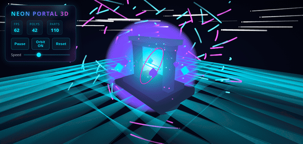

<div align="center">

<h1>Tandem MCP</h1>


<p>
  <a href="https://github.com/ALENOC/tandem-mcp/releases"></a>
  <a href="https://github.com/ALENOC/tandem-mcp/actions/workflows/tests.yml"></a>
  <a href="pyproject.toml"></a>
  <a href="LICENSE"></a>
</p>

</div>

Tandem MCP lets the model in your chat hand part of a coding task to a model running on your own machine. A typical request is “fix this function, leave the tests alone, and show me the diff.” The cloud model decides what to hand off. The local model does the edit, and Tandem returns the changes and test results for review.

## Connect your agent

Tandem runs as a local MCP server over standard input and output (stdio). The installer registers it with **Claude Code**, **Codex** and **Antigravity**. You can also register the same server manually in **Gemini CLI** or another client that can launch a local stdio server. Each client handles its own tool permissions. [Setup and manual configuration](docs/GETTING_STARTED.md#3-register-with-your-mcp-client)

## How a delegated edit works

[](assets/architecture.svg)

1. **Your agent sets the task.** Say you ask it to fix a discount calculation. The agent can call `delegate` with the goal, the file the worker may edit and the test to run.
2. **Tandem asks the local model.** The server sends the task and relevant context to your model endpoint. The model can ask to read a file, propose an edit or request a command.
3. **Tandem applies the edit and checks it.** The server handles those tool calls inside the workspace limits. It runs the requested test and records the result and the diff. Command isolation depends on the configured sandbox.
4. **Your agent reviews the result.** It can inspect the diff and test output, report a failure or request a rollback. For a read-only question, it can use a digest tool and ask for the relevant lines directly.

[Architecture in detail](docs/ARCHITECTURE.md) · [Workspace and sandbox permissions](docs/SECURITY_MODEL.md)

## Does it save cloud tokens?

On a small Python fix, calling the local worker took more cloud tokens than doing the edit directly. On a larger 3D demo, the worker wrote enough code locally to bring cloud usage down substantially. Here is what each path used **per correct result delivered within the time budget**, counting failed attempts.

| Task | Direct orchestrator | With Tandem |
| --- | ---: | ---: |
| Python discount fix | 26,953 | 33,479 (+24.2%) |
| Boids animation | 33,532 | 33,214 (-0.95%) |
| 3D Portal | 92,941 | 37,975 (-59.1%) |

**In everyday chat**, the discount fix took 24 seconds directly and 105 seconds with delegation. Both passed on the single attempt. For Boids, both paths passed all three attempts. Delegating saved about 318 cloud tokens per animation and added 8.6 minutes to the median wait. For edits like these, we use the direct path.

**For the Portal experiment**, a separate host managed the local job. The direct run passed in 110 seconds. Two of three delegated runs passed, taking 37 and 58 minutes. That is our largest saving in this comparison, with only one direct run as a reference. These figures count cloud tokens. The local worker also uses tokens and hardware time. [Results and run conditions (Italian)](docs/DECISION_REPORT_20261120.md) · [Benchmark methodology](docs/BENCHMARKS.md)

<details>
<summary>See the 3D Portal demos</summary>

Historical benchmark previews, shown in the same order as the table.

**Direct orchestrator**


**With Tandem**



</details>

## Try it

Start a local OpenAI-compatible model server and load a model. LM Studio usually listens at `http://127.0.0.1:1234/v1`. You will also need Python 3.11 or newer and, for secure command execution on Linux, Bubblewrap.

```sh
git clone https://github.com/ALENOC/tandem-mcp
cd tandem-mcp
python3 -m venv .venv
.venv/bin/pip install .
.venv/bin/python scripts/install.py
```

Restart your MCP client, open a project and try a read-only request:

> Use Tandem to find where this project validates its input. Give me the file names and line numbers.

For a first edit, pick a failing test and tell the worker which file it may change:

> Use Tandem to fix the discount calculation in discount.py. Keep the tests unchanged, run them, and show me the diff.

For manual setup or a different model endpoint, see [Getting Started](docs/GETTING_STARTED.md) and [Configuration](docs/CONFIGURATION.md). The decision report describes the experimental routing used in the chat benchmarks. The released server's tools are listed in the [tool reference](docs/TOOLS.md).

[Changelog](CHANGELOG.md) · [Security policy](SECURITY.md) · [MIT license](LICENSE) · Copyright (c) 2026 [Alessandro Nocentini](https://github.com/ALENOC)
