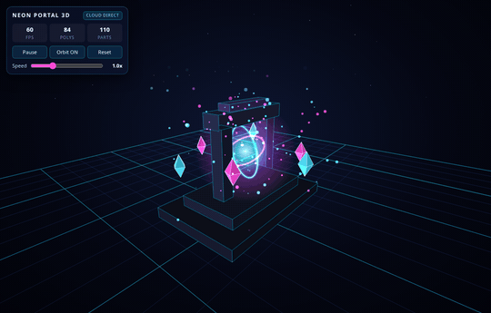
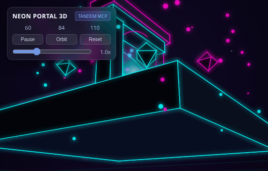

# Tandem MCP

<p align="center">
  
</p>

<p align="center">
  <a href="https://github.com/ALENOC/tandem-mcp/actions/workflows/tests.yml"></a>
  <a href="LICENSE"></a>
  
</p>

An MCP server that pairs a cloud orchestrator model with a local executor model. The orchestrator keeps the decisions and the final check; the local model reads, edits, and runs things on the machine and reports in a few lines, so large files never enter the cloud context.

Works with any OpenAI-compatible local server: **LM Studio**, **Ollama**, **llama.cpp**, **vLLM**, **Jan**, **KoboldCpp**, **LocalAI**.

> [!NOTE]
> Most "ask a local model" tools only offload text generation. Most of an agent's cost is reading material (logs, sources, reports), and small local models often hallucinate details or make syntax mistakes.
>
> **Why you can trust a small model here:** Tandem never takes the model's word for it. Before returning anything to the cloud orchestrator, the server runs deterministic Python checks (no LLM involved) to verify that every quote actually exists in the source, flag any invented numbers, check syntax on every modified file, and run your acceptance tests.

**Jump to:** [Quick Start](#quick-start) · [How to use it](#how-to-use-it) · [Tools](#tools) · [Benchmarks](#benchmarks) · [Security](#security) · [Tests](#tests)

---

## Quick Start

**1. Clone & install** (Python 3.11+):

```sh
git clone https://github.com/ALENOC/tandem-mcp
cd tandem-mcp
python3 -m venv .venv
.venv/bin/pip install .
```

**2. Register in Claude Code, Codex, and Antigravity** (one command):

```sh
.venv/bin/python scripts/install.py
```

<details>
<summary>Installer options &amp; manual MCP configuration</summary>

`scripts/install.py` options:
- `--clients claude,codex,antigravity`: select specific clients (default: all three).
- `--replace-legacy`: remove any old `lmstudio` MCP entries while installing `tandem-mcp`.
- `--env TANDEM_SANDBOX=require`: pass environment variables to the server (repeatable).
- `--dry-run`: preview changes without modifying files.
- `--uninstall`: remove `tandem-mcp` from the selected clients.

Manual stdio configuration (any MCP client):

```json
{
  "command": "/path/to/tandem-mcp/.venv/bin/python",
  "args": ["/path/to/tandem-mcp/main.py"]
}
```

`python main.py`, `python -m tandem_mcp`, and `.venv/bin/tandem-mcp` all start the same server. (Note: v3.0.0 used `tandem`; use `tandem_mcp` in v3.0.1+.)

</details>

**3. Start a local model server** and load a model. Tandem auto-detects usual ports in order: LM Studio (`1234`), Ollama (`11434`), llama.cpp (`8080`), vLLM (`8000`), Jan (`1337`), KoboldCpp (`5001`), text-generation-webui (`5000`), LocalAI (`8081`).

<details>
<summary>Environment variables &amp; model notes</summary>

| Variable | Meaning | Default |
| --- | --- | --- |
| `TANDEM_BASE_URL` | OpenAI-compatible URL (`LM_STUDIO_BASE_URL` also read) | auto-detected |
| `TANDEM_MODEL` | Model ID to use | loaded chat model |
| `TANDEM_CONTEXT` | Context length fallback when server omits it | `8192` (Ollama: `4096`) |
| `TANDEM_API_KEY` | API key if required by server | `local` |
| `TANDEM_TIMEOUT` | Per-completion timeout (seconds) | `900` |
| `TANDEM_SANDBOX` | `auto`, `require`, or `off` | `auto` |
| `TANDEM_STRICT` | `0` relaxes the strict delegation contract | `1` |
| `TANDEM_SANDBOX_NET` | `1` allows network inside sandbox | off |
| `TANDEM_HOME` | Ledger, lessons, caps, cache, and jobs folder | `~/.local/share/tandem-mcp` |
| `TANDEM_MAX_PARTS` | Most parts one `digest_*` answer may read (one executor call each) | `60` |
| `TANDEM_JOBS_PENDING_TTL_DAYS` | Days a job with changes and no verdict is kept | `120` |
| `TANDEM_LEDGER_KEEP_DAYS` | Days of ledger lines kept (`0`: all) | `180` |

**Model notes:**
- **Ollama**: raise `OLLAMA_CONTEXT_LENGTH` for `delegate` tasks; reading tools (`digest_*`) work at any context length by chunking.
- **Small contexts (< 8000 tokens)**: fine for `digest_*`, `extract_from_file`, and `ask`; tight for `delegate`.
- **Reasoning models**: reasoning blocks are stripped; disabling verbose thinking on the server speeds up mechanical tasks.

</details>

---

## How to use it

Once `tandem-mcp` is registered, **restart your client** (Claude Code, Codex, or Antigravity) so it loads the MCP server.

1. **Check the connection:** ask your agent `"Run executor_status"`: it should show your local server, loaded model, context length, and active sandbox.
2. **Talk normally (or prompt explicitly):** you don't need special syntax; the cloud agent sees Tandem's tool descriptions and calls them automatically. Typical prompts:
   - **Read large files / logs without burning cloud tokens:**
     `"Use tandem-mcp to inspect server.log and list every error with line numbers."` (`digest_file`)
   - **Survey a folder:**
     `"Ask tandem-mcp what each Python module in src/ is responsible for."` (`digest_many`)
   - **Delegate a bounded edit with tests:**
     `"Delegate fixing the failing test in tests/test_auth.py to tandem-mcp, then show me job_diff."` (`delegate` -> `job_diff` -> `job_feedback` or `job_rollback`)
   - **Check real savings:**
     `"Show me ledger_report for the last 7 days."` (`ledger_report`)

<details>
<summary>Optional: add a rule to CLAUDE.md / AGENTS.md / GEMINI.md so your agent prefers Tandem automatically</summary>

```markdown
When `tandem-mcp` is available:
- Use `digest_file` (with `grep` when searching) or `digest_many` to inspect large files, logs, and unfamiliar modules instead of reading them directly into cloud context.
- Use `delegate` for bounded, test-verified mechanical edits, then review `job_diff` and close with `job_feedback` or `job_rollback`.
```

</details>

---

## Why Tandem

- **Strict contracts (`delegate`)**: bounded workspace, required `write_globs` and server-run `verify_commands`, `constraints`, `immutable` files, `allow_run` regexes. A task without limits is refused before the local model is called.
- **Meaningful checks**: baseline runs before work (pre-passing checks are flagged as `weak`); test files/folders are auto-protected (`read-only`) and restored if touched; changed files are syntax-checked.
- **Checked evidence (`digest_*`, `extract_from_file`)**: every quote is verified lexically against the source, `quote_found` is separated from `claim_supported`, ungrounded numbers are listed, and >2000-char line truncation is signaled.
- **Supervised memory**: `job_feedback` stores project lessons; `job_continue` resumes stopped jobs in the same conversation; `ledger_report` tracks savings and quote failure rates.
- **Any model**: `executor_probe` adapts automatically to native tool calling or JSON-reply fallback.

<details>
<summary>Comparison with houtini-lm, local-vibes, and Atomic Agent Fusion (Nov 2026)</summary>

Compared in November 2026 from each project's README (not from running them). `"no"` means the README does not describe the feature.

| Feature | Tandem | houtini-lm | local-vibes | Atomic Agent Fusion |
| --- | --- | --- | --- | --- |
| Local file-editing tool loop | yes | no | yes | yes |
| Server-run checks + repair loop | yes | no | no | `verify.run` (loop unconfirmed) |
| Baseline check (flags pre-passing) | **yes** | no | no | no |
| Read-only test protection + restore | **yes** | no | no | no |
| Per-task journal, diff & rollback (no git) | **yes** | no | diff stat only | opt-in worktrees |
| Quotes & numbers checked against source | **yes** | no | no | no |
| Agreement score (`samples`) | **yes** | no | no | no |
| Orchestrator feedback -> project lessons | **yes** | no | no | episode reflection |
| Resume stopped task with hint | **yes** | no | no | partly |
| Non-tool-calling models supported | yes (JSON) | n/a | no | yes (grammar) |
| Model capability probing | yes (`probe`) | per-family | no | unconfirmed |
| Pipeline-aware command allow list | **yes** | n/a | no | approval ladder |
| OS sandbox (bubblewrap) | yes | n/a | path only | env secret strip |
| Parallel tasks with file claims | yes | no | separate dirs | yes (waves) |
| Token savings & quality accounting | yes | yes | no | per-worker cost |

</details>

---

## Tools

| Tool | Purpose |
| --- | --- |
| `executor_status` | Active server, models, context length, capabilities, and sandbox status |
| `executor_probe` | Measure native tool calls, forced JSON schema, reasoning, and speed |
| `ask` | Text task with optional `json_schema` and `samples` agreement score |
| `digest_file` | Q&A on a file (text, code, log, JSON, PDF) with checked quotes and `grep` filter |
| `digest_command` | Run an orchestrator command and get exit code, verdict, and full log path |
| `digest_many` | Ask the same question across many files (`glob`), one line per file |
| `extract_from_file` | Structured JSON extraction with ungrounded values flagged |
| `delegate` | Bounded coding task with `verify_commands`, `write_globs`, `immutable`, `allow_run` |
| `delegate_many` | Dependency-ordered batch (`after`) with parallel file ownership and rollback |
| `job_status`, `job_evidence`, `job_diff`, `job_rollback` | Inspect status, the lines cited for each constraint, the unified diff, and undo changes per job or batch |
| `job_continue` | Resume a stopped job with a hint in the same conversation |
| `job_feedback`, `lesson_add`, `lessons` | Record verdicts and manage standing project/global rules |
| `ledger_report` | Calls, tokens, estimated cloud savings, and per-model quality stats |

<details>
<summary>Example delegated task &amp; receipt states</summary>

```python
delegate(
  goal="test_calc.py fails: dbm_to_mw(20) must return 100. Fix the formula in calc.py so that the test passes.",
  workspace="/path/to/project",
  write_globs=["calc.py"],
  verify_commands=["python3 test_calc.py"],
  allow_run=["^python3 test_calc\\.py$"]
)
```

```text
job 20261112-224042-d6d2a6: VERIFIED  (6 steps, 0 repairs, 182.0 s, 10728 executor tokens, native tool calls)
executor: Fixed dbm_to_mw to use 10**(dbm/10) instead of 10**(dbm/20).
  changed calc.py  +3 -1
  syntax ok: calc.py
  check PASS  $ python3 test_calc.py  (failed before the job)
Checks passed. Read job_diff if the change is delicate, then job_feedback.
```

**Strict contract (default).** The quality of what the local model returns is set by the contract the orchestrator writes, so the server refuses a `delegate` or `delegate_many` task that leaves the executor without limits:

| The contract must give | Refused when |
| --- | --- |
| A goal with concrete targets | it has fewer than 8 words or no file path, symbol or exact value |
| `write_globs` | it is empty, or a glob matches every file (`*`, `**/*`) |
| `verify_commands` | it is empty, or a check cannot fail (`true`, `echo`, `exit 0`) |
| `constraints` | the checks only look for text or files (`grep`, `test`, `ls`) and no constraint says what must hold |
| `constraints` with the design decisions | the task writes files whose look no command proves (`.html`, `.css`, `.svg`, UI components) |
| A check that fails before the work, or `constraints` | every check already passes at the baseline and there is no constraint: the job stops before the executor starts |
| Atomic `constraints` | a constraint holds several requirements (longer than 160 characters, parts joined by `;`, or more than one sentence) |
| Evidence for every constraint at `finish` | the executor cites no line of a file for a constraint, or the quote is not in the file: the work goes back, and without evidence the job ends `checks_failed` |
| `job_evidence` or `job_diff` read before `job_feedback(accepted=True)` | neither the cited lines nor the diff were inspected |

The receipt lists, under each constraint, the line the executor cited (`path:line "quote"`), already looked up in the file. `job_evidence` shows those lines with their surroundings, a few dozen lines instead of the whole diff, and is enough to accept a job that is verified by checks that failed before the work and whose constraints all have evidence. Lines that no constraint cites are covered by the checks only: `job_diff` remains for reading the whole change. Write the contract as an interface, not as a wish: exact names, numbers and formulas in the goal and the constraints, and a check that runs the code. Design stays with the orchestrator: every decision (structure, layout, colors, sizes, motion) goes into the contract before the work, because the executor takes the simplest reading of what is left unsaid and the orchestrator can only check the result against what the contract says. `TANDEM_STRICT=0` brings back the loose contract.

**States:** `verified`, `unverified`, `checks_failed`, `blocked`, `stuck`, `out_of_steps`, `out_of_time`, `error`.

</details>

---

## Security

Read this before pointing Tandem at a sensitive repository:

- **Sandboxed execution (`bubblewrap`)**: when available, both executor `run` commands and `verify_commands` run inside `bubblewrap` (`--ro-bind / /`, workspace writable, `.git` and `SKIP_DIRS` read-only, home credential folders hidden, `/run/user` replaced by an empty folder and every other Unix socket under `/run` masked (session bus, Docker socket, key agents), `SECRET_ENV` vars stripped, `--unshare-net` and `--unshare-ipc` enabled).
- **Explicit exceptions**: pass `checks_network=True` or `unjailed_checks=True` on `delegate` only for checks that need network or host resources. `digest_command` runs the orchestrator's own command with the user's rights.
- **Fail-closed mode**: on systems without `bubblewrap`, `TANDEM_SANDBOX=auto` falls back to command-text checks (`allow_run` + `DENY` list) with a warning in `executor_status`. Set `TANDEM_SANDBOX=require` to fail closed with `SandboxError` instead.
- **Contract enforcement on shell commands**: `stamp()` hashes every workspace file with SHA-256 before and after `run` (no file-count cap, symlinks excluded). Any file modified outside `write_globs` or owned by another parallel task is reverted immediately. A generated folder (`build`, `dist`, `node_modules`, ...) that a command creates is removed when it lies outside `write_globs` or inside the files of the checks, otherwise it is listed in the receipt and removed by `job_rollback`.
- **Allow list**: an `allow_run` pattern matches anywhere in a command part, so anchor it (`^pytest\b`). Shell comments are dropped before matching, and command substitution and `$'...'` quoting are refused. The safety list refuses `ssh`, `kill`, `source` and the like as the command of a part (also behind `env`, `xargs`, `sh -c`), not as a word among its arguments.
- **Workspace**: `/`, the home folder and the folders above it, system folders (`/etc`, `/usr`, `/tmp` itself, ...) and credential folders (`~/.ssh`, ...) are refused as a workspace.
- **API key**: `TANDEM_API_KEY` is sent only to the configured or selected server, never to the other local ports tried during discovery. The data folder is private to the user (`0700`).
- **Safe rollback**: `journal_bin.json` + `snapshot.json` back up original bytes (up to 2 MB/file, 50 MB total). Pre-existing files larger than the cap are tracked as `None` so `job_rollback` preserves them instead of deleting them; `post_state.json` prevents overwriting later user edits.
- **Hostile text**: file contents and command output are marked as data in prompts, and receipts/diffs should always be reviewed before accepting. See [SECURITY.md](SECURITY.md) to report vulnerabilities.

---

## Benchmarks

> **Trade-off first.** Tandem can save cloud tokens, and it is slower: the work runs on the local model, whose speed depends on your hardware (here about 11 tokens per second). Reading and test-driven fixes save 59 to 99% of the cloud tokens for seconds to minutes of waiting. Generating new code from a contract keeps the quality but saves much less, because the design has to be written into the contract, and it takes tens of minutes instead of one cloud turn.

Reproducible suite: [benchmarks/run_benchmark.py](benchmarks/run_benchmark.py) · Full report: [benchmarks/RESULTS.md](benchmarks/RESULTS.md)

Orchestrator `Fable 5.2` (cloud) and executor `qwen3.8-27b@iq3_s` (LM Studio, `65536` ctx, `11.2 tok/s` probed), Tandem 3.1.0 with the strict contract, cache disabled, `1 cloud tok = 3.6 chars`, on **Intel Core i9-9900K @ 3.60GHz (16 threads)**, **22 GiB RAM**, **AMD Radeon Navi 21 (RX 6800/6900 XT, 16 GiB VRAM)**, Linux x86_64.

<details>
<summary>LM Studio configuration used for the executor</summary>

IQ3_S quantization, 65536 context, all 65 layers on the GPU, flash attention and MTP speculative decoding are the settings that weigh most on the times below.

| Load setting | Value | | Inference setting | Value |
| --- | --- | --- | --- | --- |
| Model file | `unsloth/Qwen3.8-27B-GGUF/Qwen3.8-27B-UD-IQ3_S.gguf` (12.04 GB, 27B, IQ3_S) | | Temperature | 0.15 (Tandem sets its own per call: 0.1, and 0.7 for extra `ask` samples) |
| Runtime | LM Studio 0.4.28, `llama.cpp` Vulkan (`linux-x86_64-vulkan-avx2` 2.73.0) | | Top K / Top P / Min P | 20 / 0.95 / 0.05 |
| Context length | 65536 (model supports 262144) | | Repeat penalty | 1 |
| GPU offload | 65 layers (all) | | Presence penalty | off |
| CPU thread pool | 8 | | Thinking | enabled, reasoning budget 1024 tokens |
| Evaluation / physical batch | 1024 / 512 | | Context overflow | rolling window |
| Max concurrent predictions | 1 | | Limit response length | off |
| Unified KV cache | on | | Structured output | off (Tandem sends a schema per call) |
| KV cache on GPU | on, K cache `Q8_0`, V cache `Q4_0` | | Seed | random |
| Flash attention | on | | | |
| Context checkpoints | 32 | | | |
| Keep model in memory / mmap | on / on | | | |
| On-demand tensor loading | auto | | | |
| Speculative decoding | MTP, max draft tokens 4, min 0, draft probability 0.75 | | | |
| RoPE frequency base / scale | auto / auto | | | |

</details>

**Reading, command digest and extraction (`digest_file`, `digest_many`, `digest_command`, `extract_from_file`)**

| Task | Source → Cloud | Cloud saved (est.) | Local tokens | Time | Evidence |
| --- | --- | ---: | ---: | ---: | --- |
| Full-file doc QA (`README.md`) | 27.9 KB → 405 B | **~7,649 tok (98.6%)** | 10,298 | 66.2 s | 0 ok / 2 dropped (`unsupported`) |
| Targeted grep QA (`agent.py`) | 85.9 KB → 692 B | **~23,666 tok (99.2%)** | 643 | 14.1 s | 3 ok / 0 dropped (`quote_only`) |
| Multi-file package survey (`tandem_mcp/*.py`) | 209.8 KB → 1.5 KB | **~57,846 tok (99.3%)** | 108,207 | 800.3 s | 8 ok / 0 dropped (`checked`) |
| Recent git history (`git log -n 30 --stat`) | 18.1 KB → 1.4 KB | **~4,614 tok (92.0%)** | 18,528 | 109.9 s | 8 ok / 0 dropped |
| Project manifest (`pyproject.toml`) | 786 B → 113 B | **~187 tok (85.6%)** | 633 | 9.8 s | schema validated, 0 values not in the source |

**Delegated fixes with an existing test (`delegate`)**

| Task | Baseline → Receipt | Cloud saved (est.) | Local tokens | Time | Result |
| --- | --- | ---: | ---: | ---: | --- |
| Micro bugfix (1 tiny file, 6 lines) | 1.0 KB → 432 B | **~171 tok (58.7%)** | 6,297 | 25.3 s | `VERIFIED` (4 steps, 0 repairs) |
| Multi-file bugfix (`config_loader.py` + 3 other files) | 6.1 KB → 476 B | **~1,561 tok (92.2%)** | 8,066 | 32.8 s | `VERIFIED` (4 steps, 0 repairs) |

### Generation from a contract: same quality, smaller saving, longer wait

Each demo was produced twice: written directly by `Fable 5.2`, and written by `qwen3.8-27b@iq3_s` under a strict contract that `Fable 5.2` wrote once, before any output existed. Nothing was fixed after generation, and the result was judged against the contract only, as an orchestrator without a reference solution would.

| Orbital simulation, direct (`Fable 5.2`) | Orbital simulation, with Tandem (orchestrator `Fable 5.2` + executor `qwen3.8-27b@iq3_s`) |
| :---: | :---: |
|  |  |
| **3D neon portal, direct (`Fable 5.2`)** | **3D neon portal, with Tandem (orchestrator `Fable 5.2` + executor `qwen3.8-27b@iq3_s`)** |
|  |  |

| | Orbital animation, direct (`Fable 5.2`) | Orbital animation, with Tandem (`Fable 5.2` + `qwen3.8-27b@iq3_s`) | 3D portal, direct (`Fable 5.2`) | 3D portal, with Tandem (`Fable 5.2` + `qwen3.8-27b@iq3_s`) |
| --- | ---: | ---: | ---: | ---: |
| Who writes the code | `Fable 5.2` | `qwen3.8-27b@iq3_s` under a contract by `Fable 5.2` | `Fable 5.2` | `qwen3.8-27b@iq3_s` under 4 contracts by `Fable 5.2` |
| Output | 11,956 B, 272 lines | 12,499 B, 459 lines | 15,122 B, 327 lines | 18,243 B, 616 lines in 4 files |
| Cloud output tokens | ~3,321 (the file) | ~2,343 (contract 4,450 + check harness 3,986 chars) | ~4,201 (the file) | ~2,396 (contracts 6,874 + check harness 1,753 chars) |
| Cloud output tokens saved | n/a | **29.4%** | n/a | **43.0%** |
| Cloud input tokens to inspect | 0 | ~4,199 (receipt + `job_evidence`) | 0 | ~7,814 (receipts + `job_evidence`) |
| Local tokens | 0 | 104,087 | 0 | 199,182 |
| Wall time | one cloud turn | **1121 s** (19 min) | one cloud turn | **1890 s** (31 min) |
| Contract | n/a | 46 atomic constraints, 1 check that runs the page | n/a | 69 atomic constraints, checks that run the modules |
| Executor result | n/a | `VERIFIED`, 9 steps, 0 repairs | n/a | 4 of 4 tasks `VERIFIED`, 0 repairs |
| Constraints met on inspection | n/a | 46 of 46 | n/a | 67 of 69 |
| Fixes after generation | none | none | none | none |
| Headless render | 60 FPS, no error | 60 FPS, no error | 60 FPS, 84 polygons, no error | 60 FPS, 84 polygons, no error |
| Demo | [live](https://alenoc.github.io/tandem-mcp/benchmarks/animation_without_tandem/) ([source](benchmarks/animation_without_tandem/index.html)) | [live](https://alenoc.github.io/tandem-mcp/benchmarks/animation_with_tandem/) ([source](benchmarks/animation_with_tandem/index.html)) | [live](https://alenoc.github.io/tandem-mcp/benchmarks/scene3d_without_tandem/) ([source](benchmarks/scene3d_without_tandem/index.html)) | [live](https://alenoc.github.io/tandem-mcp/benchmarks/scene3d_with_tandem/) ([source](benchmarks/scene3d_with_tandem/)) |

Side by side in the browser: **[orbital simulation](https://alenoc.github.io/tandem-mcp/benchmarks/animation_comparison.html)** · **[3D neon portal](https://alenoc.github.io/tandem-mcp/benchmarks/scene3d_comparison.html)**

What these runs show:

- **Quality is preserved when the design is in the contract.** With 46 and 69 atomic constraints the local model delivered both demos at the first attempt with no repair. An earlier run with the bare user prompt was also `VERIFIED`, and looked plainer: the design decisions had been left to the local model.
- **The saving on cloud output tokens is 29.4% and 43.0%**, because the contract and the check harness cost most of what writing the code costs. Adding the input tokens of receipts and inspection, generation through Tandem used more cloud tokens in total than writing the code directly.
- **It takes 19 and 31 minutes** on this hardware, against one cloud turn.
- **`VERIFIED` is not perfection.** Reading the cited lines found two constraints of the 3D engine that are not met as written (polygons are sorted by distance from the scene origin instead of camera depth). The result is published as delivered.

Use Tandem for generation when cloud output tokens matter more than time, or when the specification exists anyway. Use it for reading and test-driven fixes almost always.

<details>
<summary>Exact prompt used for the orbital simulation</summary>

```text
Create a single self-contained file index.html implementing an interactive full-viewport HTML5 Canvas orbital particle simulation in dark space (#060913):
1. Responsive full-window <canvas> using requestAnimationFrame and devicePixelRatio scaling.
2. Central glowing star using createRadialGradient and a subtle corona pulse.
3. At least 5 orbiting planets with distinct orbital radii, speeds, colors, at least 3 moons/satellites, and fading orbital trails.
4. Twinkling background starfield with at least 150 stars.
5. Interactive glassmorphism HUD overlay with:
   - Play/Pause toggle button
   - Trails ON/OFF toggle button
   - Reset button
   - Speed range slider (<input type="range" min="0.2" max="3.0" step="0.1" value="1.0">) with live multiplier readout
   - Live FPS, simulation time (s), and active burst particle count
6. Clicking anywhere on the canvas spawns a radial burst of glowing particles with velocity damping and fade-out.
Keep everything self-contained in index.html with zero external dependencies and valid JavaScript syntax.
```

The contract of the Tandem variant adds 46 constraints to this prompt: [benchmarks/contracts/animation.json](benchmarks/contracts/animation.json). The four contracts of the 3D portal are in [benchmarks/contracts/scene3d.json](benchmarks/contracts/scene3d.json).

</details>

---

## Tests

```sh
.venv/bin/python tests/test_offline.py     # 231 checks: limits, evidence, journal, rollback, installer
.venv/bin/python tests/test_protocol.py    # 169 checks: full loop against scripted server (no model)
.venv/bin/python tests/test_live.py        # live checks against your running local model
.venv/bin/python tests/test_live.py --text # live checks via JSON-reply protocol
```

<details>
<summary>Measured on real models (tests/test_live.py, Nov 2026) &amp; repository layout</summary>

| Model | Server | Context | Protocol | Result |
| --- | --- | --- | --- | --- |
| Qwen 3.8 27B (IQ3_S) (`qwen3.8-27b@iq3_s`) | LM Studio | 65536 | native tool calls | 12 of 12 |
| Qwen 3.8 27B (IQ3_S) (`qwen3.8-27b@iq3_s`) | LM Studio | 65536 | JSON replies | 12 of 12 |
| Gemma 4 E2B (Q4_K_M) (`gemma4:e2b`) | Ollama | 4096 | native tool calls | 12 of 12 (1 repair) |
| Gemma 4 E2B (Q4_K_M) (`gemma4:e2b`) | Ollama | 4096 | JSON replies (prompt) | reading 7/7; fix verified 1/3 |

**Repository layout:**
- `tandem_mcp/server.py`: MCP tools and receipts
- `tandem_mcp/engine.py`: server discovery, probing, completions, JSON schema validation
- `tandem_mcp/digest.py`: chunked reading, quote/claim checks, extraction, agreement
- `tandem_mcp/agent.py`: executor loop, journal, snapshot, guard, batches, rollback
- `tandem_mcp/sandbox.py`: workspace/command limits, SHA-256 stamp, bubblewrap sandbox
- `tandem_mcp/store.py`: ledger, lessons, model caps, cache & job retention
- `scripts/install.py`: one-command installer for Claude Code, Codex, and Antigravity
- `benchmarks/`: reproducible benchmark script and results

</details>

## License & Attribution

MIT License: Copyright (c) 2026 **Alessandro Nocentini** ([@ALENOC](https://github.com/ALENOC)), see [LICENSE](LICENSE).

If you fork this repository or build projects inspired by `tandem-mcp`'s architecture and ideas (cloud-orchestrator / local-executor pairing, lexical evidence verification, contract enforcement, and snapshot/rollback), please include clear attribution to **Alessandro Nocentini** and link to [github.com/ALENOC/tandem-mcp](https://github.com/ALENOC/tandem-mcp) (`@ALENOC`).
