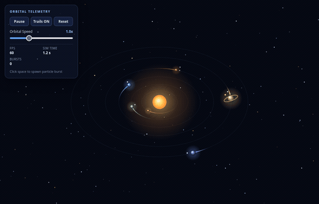
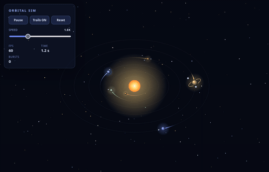
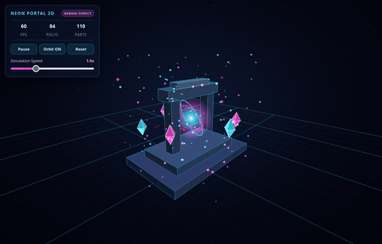
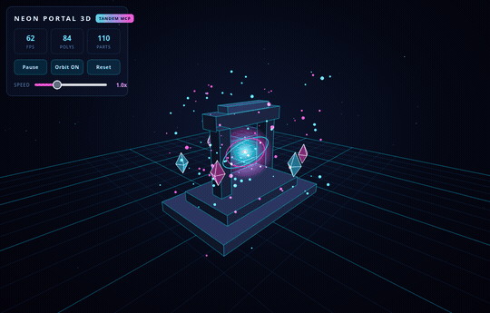

<div align="center">

<h1>Tandem MCP</h1>


<p><strong>Your cloud AI plans. Your local AI executes. Tandem verifies.</strong></p>

<p>
  <a href="https://github.com/ALENOC/tandem-mcp/releases"></a>
  <a href="https://github.com/ALENOC/tandem-mcp/actions/workflows/tests.yml"></a>
  <a href="pyproject.toml"></a>
  <a href="LICENSE"></a>
</p>

<p><strong>Delegate locally. Verify deterministically. Keep control.</strong></p>

</div>

Tandem MCP is an MCP server that pairs a cloud AI orchestrator (Claude Code, Codex, Gemini) with a local OpenAI-compatible LLM (LM Studio, Ollama, llama.cpp, vLLM). The cloud model keeps architectural decisions and final review; the local model reads large files and executes bounded edits while Tandem enforces contracts, runs checks, verifies quotes, and enables rollback.

---

## Architecture: How Tandem Works

<p align="center">
   Tandem MCP Server -> Local AI Executor">
</p>

1. **Plan:** The cloud orchestrator decides what to read or delegate and sets explicit contract limits.
2. **Execute:** Tandem sends a bounded task to the local model inside a confined workspace.
3. **Verify:** Tandem runs syntax checks, acceptance tests, and lexical quote/number verification.
4. **Review:** The orchestrator inspects `job_evidence` or `job_diff` and accepts (`job_feedback`) or restores (`job_rollback`).

The local model does not receive unrestricted control over the machine. Actual isolation strength depends on configuration and platform (Bubblewrap on Linux vs command-text checks in compatibility mode).

Learn more -> [Architecture](docs/ARCHITECTURE.md) ([English PDF](docs/tandem-mcp-architecture.pdf) · [Italian PDF](docs/tandem-mcp-architettura.pdf))

---

## Why Tandem MCP?

- **Save cloud context:** The local model reads large files, logs, and docs, returning only verified answers and quotes.
- **Controlled delegation:** Tasks are bounded by contracts, writable globs, command allow lists, and read-only test guards.
- **Deterministic verification:** Baseline checks, syntax validation, lexical quote checks, and acceptance tests verify results without trusting the local model's word.
- **Local model flexibility:** Works with **LM Studio**, **Ollama**, **llama.cpp**, **vLLM**, and other OpenAI-compatible endpoints, with role-based model routing.
- **Review and rollback:** Inspect diffs and cited lines before accepting, and restore recoverable changes without overwriting later user edits.
- **Usage insights:** Track calls, local tokens, retry counts, and estimated cloud input savings in `ledger_report`.

---

## Benchmarks — Tandem MCP v3.6.1

### Measured Comparative Evaluation (Gemini 4 Hydrogen + Qwen 27B)

Three-way comparison on frozen `v3.6.1` (`010cbb6`) fixtures: **Gemini Direct** vs **Gemini + Direct LM Studio** vs **Gemini + Tandem MCP** (`gemini-4-hydrogen-medium`, `qwen3.8-27b@iq3_s` on LM Studio, real cloud tokens measured via `agy --output-format json`). Negative savings mean Tandem used more total cloud tokens than Gemini Direct.

| Workload | Cloud Tokens Saved | Success | Median Time |
| --- | ---: | ---: | ---: |
| Reading (`grep` on `agent.py`, `n=3`) | -31.0% | 100% | 69.8 s |
| Extraction (`pyproject.toml`, `n=3`) | -23.4% | 100% | 38.5 s |
| Micro bugfix (6 lines, `n=3`) | -12.5% | 100% | 60.5 s |
| Multi-file bugfix (4 files, `n=3`) | **+10.3%** | 100% | 85.1 s |
| Orbital animation (`n=1`) | N/A (timeout) | 100% | 2,400.1 s |

*(Note: vs. Direct LM Studio, Tandem achieved higher schema reliability on extraction [100% vs 33.3%] and used 14x–40x fewer local tokens on `grep`/package surveys.)*

### Context Reduction (Historical v3.6.1 Suite, Estimated)

Derived from source bytes vs. returned digest/receipt bytes (`1 cloud tok = 3.6 chars`, **Estimated** context compression — not net cloud token savings):

| Workload | Context Reduction (Est.) | Local Tokens | Time / Verified |
| --- | --- | ---: | --- |
| Full-file QA (`README.md`) | 90.4% (~2,127 tok) | 3,602 | 36.2 s · `contested` (1/3 quotes) |
| Targeted grep QA (`agent.py`) | 99.5% (~27,572 tok)* | 837 | 22.2 s · `quote_only` (2/2 quotes) |
| Multi-file survey (`8 files`) | 99.4% (~69,202 tok) | 107,172 | 864.0 s · `checked` (11/11 quotes) |
| Git history (`30 commits`) | 96.8% (~3,554 tok) | 53,712 | 420.6 s · completed |
| Extraction (`pyproject.toml`) | 85.6% (~187 tok) | 633 | 11.9 s · schema valid (0 loose) |
| Micro bugfix (6 lines) | 58.7% (~171 tok) | 6,498 | 27.7 s · `VERIFIED` (0 repairs) |
| Multi-file bugfix (4 files) | 92.2% (~1,561 tok) | 8,278 | 37.1 s · `VERIFIED` (0 repairs) |
| Orbital animation (1 file) | 42.7% output (~1,748 tok)** | 63,324 | 984.2 s · `VERIFIED` (46/46 met) |
| 3D neon portal (4 modules) | 51.0% output (~2,491 tok)** | 237,029 | 2,464.4 s · `VERIFIED` (69/69 met) |

*\*Full-file Context Reduction (Estimated); vs. efficient-search Gemini Direct, actual cloud token savings were -31.0%.*
*\*\*Excludes ~5,529 and ~9,708 est. cloud input tokens to inspect receipts and `job_evidence`.*

### Visual Demos (Vertical Previews)

**Orbital Simulation — Direct (`Gemini 4 Hydrogen`) vs. Tandem (`v3.6.1` + `qwen3.8-27b@iq3_s`)**

<p align="center">
  
</p>
<p align="center">
  
</p>

**3D Neon Portal — Direct (`Gemini 4 Hydrogen`) vs. Tandem (`v3.6.1` + `qwen3.8-27b@iq3_s`)**

<p align="center">
  
</p>
<p align="center">
  
</p>

- **Comparative Suite (v3.6.1):** [Comparative Report](benchmarks/comparative_3_6_1/RESULTS.md) · [Suite README](benchmarks/comparative_3_6_1/README.md) · [Raw JSON](benchmarks/comparative_3_6_1/runs/20261117-075357/results.json)
- **Historical Gemini (v3.6.1):** [Gemini Report](benchmarks/gemini_3_6_1/RESULTS.md) · [Orbital Comparison](https://alenoc.github.io/tandem-mcp/benchmarks/gemini_3_6_1/animation_comparison.html) · [3D Portal Comparison](https://alenoc.github.io/tandem-mcp/benchmarks/gemini_3_6_1/scene3d_comparison.html)
- **Historical Fable (v3.1.0):** [Fable Report](benchmarks/RESULTS.md) · [Orbital Comparison](https://alenoc.github.io/tandem-mcp/benchmarks/animation_comparison.html) · [3D Portal Comparison](https://alenoc.github.io/tandem-mcp/benchmarks/scene3d_comparison.html)

---

## Quick Start

**Prerequisites:** Python 3.11+, a local OpenAI-compatible server (e.g. **LM Studio**), and `bubblewrap` on Linux for OS-level sandboxing.

**1. Install**

```sh
git clone https://github.com/ALENOC/tandem-mcp
cd tandem-mcp
python3 -m venv .venv
.venv/bin/pip install .
```

**2. Start a local LLM server (LM Studio example)**

Open **LM Studio**, load a model, and start the local server on its default OpenAI-compatible endpoint:

```text
http://127.0.0.1:1234/v1
```

(The endpoint can differ depending on your LM Studio or Ollama/vLLM configuration; Tandem auto-detects common local ports or reads `TANDEM_BASE_URL`.)

**3. Register with your MCP client**

```sh
.venv/bin/python scripts/install.py
```

Restart your MCP client (Claude Code, Codex, or Antigravity), then run your first check:

```text
Run executor_status
```

See [Getting Started](docs/GETTING_STARTED.md) for manual stdio JSON configs, installer flags, and multi-client setup.

---

## Typical Prompts

**Analyze large logs** (`digest_file`)
```text
Use tandem-mcp to inspect server.log and list every error with line numbers.
```

**Understand a codebase** (`digest_many`)
```text
Ask tandem-mcp what each Python module in src/ is responsible for.
```

**Fix a bug safely** (`delegate` -> `job_diff` -> `job_feedback` / `job_rollback`)
```text
Delegate fixing the failing test in tests/test_auth.py to tandem-mcp, then show me job_diff.
```

**Check token usage** (`ledger_report`)
```text
Show me ledger_report for the last 7 days.
```

> **Want your AI agent to use Tandem automatically?** Add standing rules to `CLAUDE.md`, `AGENTS.md`, or `GEMINI.md` (see [Getting Started](docs/GETTING_STARTED.md#5-optional-agent-instructions-claudemd-agentsmd-geminimd)).

---

## Features Overview

- **Read & Analyze:** `ask`, `digest_file`, `digest_many`, `extract_from_file`
- **Delegate & Execute:** `delegate`, `delegate_many`, `digest_command`
- **Inspect & Control:** `job_status`, `job_diff`, `job_evidence`, `job_feedback`, `job_rollback`, `job_continue`, `job_stop`
- **Models & Monitoring:** `executor_status`, `executor_probe`, `ledger_report`
- **Project Knowledge:** `lesson_add`, `lessons`

See the [Complete MCP Tool Reference](docs/TOOLS.md).

---

## Security by Design

- **OS sandbox (`bubblewrap`):** On Linux, `TANDEM_SANDBOX` defaults to `secure` (fail-closed if `bubblewrap` is unavailable). Commands run with allowlisted system dirs, an empty tmpfs over host `$HOME`, `/tmp`, and `/run`, read-only `SKIP_DIRS`, stripped secret env vars, and network/PID/IPC namespace isolation.
- **Compatibility mode warning:** On systems without `bubblewrap` (macOS, Windows, or `TANDEM_SANDBOX=compatible`/`auto`), commands run **without OS filesystem isolation**, relying on command-text checks (`allow_run`/`DENY`), outbound symlink refusal, and workspace `stamp()` verification.
- **Contracts & file protection:** Strict contracts require concrete goals, `write_globs`, and `verify_commands`. Protected test files are restored automatically if modified.
- **Snapshots, rollback & redaction:** Edits are journaled and pre-run files are snapshotted up to configurable caps (`TANDEM_REQUIRE_FULL_BACKUP=1` enforces full backup coverage; incomplete rollbacks report `partial_rollback`). Tool outputs redact detected secrets by default.

See [Security Model](docs/SECURITY_MODEL.md) for full details and [SECURITY.md](SECURITY.md) to report vulnerabilities.

---

## Performance & Benchmarks

Tandem trades local execution time for reduced cloud context on **reading** and **test-driven fixes**. Generating brand-new code from a contract preserves quality when design is written into constraints, but adds contract-authoring and review overhead so total cloud savings are smaller or negative compared to one cloud turn.

- **Latest full suite (`3.6.1`, Nov 2026):** Measured with `Gemini 4 Hydrogen` + `qwen3.8-27b@iq3_s` on i9-9900K / RX 6800 XT (58.7%-99.5% estimated cloud input savings on reading/bugfixes; 46/46 and 69/69 constraints on full demo generation).
- **Live validation (`3.5.1`, Nov 2026):** Measured on LM Studio (`qwen3.8-27b@iq3_s`, `10.7 tok/s` probed): `digest_file` `14.84 s`, `delegate` bugfix `23.78 s` (`5,124` local tokens, `VERIFIED`, `0` repairs) vs direct LM Studio completion `8.46 s` (`305` local tokens, unverified).
- **Historical suite (`3.1.0`, Nov 2026):** Measured with `Fable 5.2` + `qwen3.8-27b@iq3_s` on i9-9900K / RX 6800 XT (58.7%-99.3% estimated cloud input savings on reading/bugfixes; 19-31 min on full demo generation).

See [Benchmarks](docs/BENCHMARKS.md) for full tables, hardware specs, and methodology.

---

## Comparison With Alternatives

Rather than merely connecting a cloud agent to a local LLM, Tandem introduces bounded delegation, deterministic checks, lexical evidence tracking, and controlled review with journaled rollback.

See the [full comparison](docs/COMPARISON.md) (compiled Nov 2026 from public READMEs).

---

## Documentation

- [Getting Started](docs/GETTING_STARTED.md)
- [Architecture](docs/ARCHITECTURE.md) ([English PDF](docs/tandem-mcp-architecture.pdf) · [Italian PDF](docs/tandem-mcp-architettura.pdf))
- [MCP Tools Reference](docs/TOOLS.md)
- [Security Model](docs/SECURITY_MODEL.md)
- [Configuration](docs/CONFIGURATION.md)
- [Benchmarks](docs/BENCHMARKS.md)
- [Comparison With Alternatives](docs/COMPARISON.md)
- [Changelog](CHANGELOG.md)

---

## License & Attribution

[MIT License](LICENSE) · Copyright (c) 2026 **Alessandro Nocentini** ([@ALENOC](https://github.com/ALENOC)) · [Security Policy](SECURITY.md)
