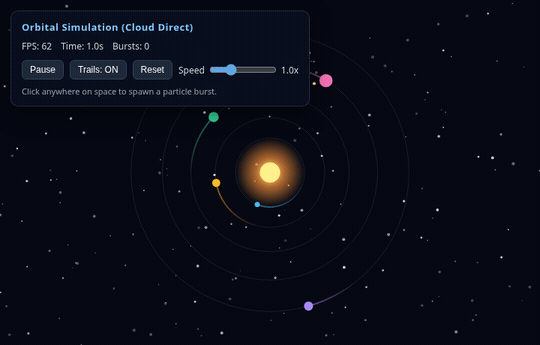
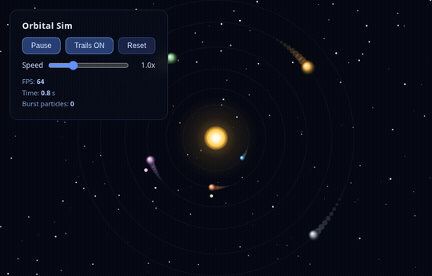

# Tandem MCP

<p align="center">
  
</p>

<p align="center">
  <a href="https://github.com/ALENOC/tandem-mcp/actions/workflows/tests.yml"></a>
  <a href="LICENSE"></a>
  
</p>

An MCP server that pairs a cloud orchestrator model with a local executor model. The orchestrator keeps the decisions and the final check; the local model reads, edits, and runs things on the machine and reports in a few lines, so large files never enter the cloud context.

Works with any OpenAI-compatible local server: **LM Studio**, **Ollama**, **llama.cpp**, **vLLM**, **Jan**, **KoboldCpp**, **LocalAI**.

> [!NOTE]
> Most "ask a local model" tools only offload text generation. Most of an agent's cost is reading material (logs, sources, reports), and small local models often hallucinate details or make syntax mistakes.
>
> **Why you can trust a small model here:** Tandem never takes the model's word for it. Before returning anything to the cloud orchestrator, the server runs deterministic Python checks (no LLM involved) to verify that every quote actually exists in the source, flag any invented numbers, check syntax on every modified file, and run your acceptance tests.

**Jump to:** [Quick Start](#quick-start) · [How to use it](#how-to-use-it) · [Tools](#tools) · [Benchmarks](#benchmarks) · [Security](#security) · [Tests](#tests)

---

## Quick Start

**1. Clone & install** (Python 3.11+):

```sh
git clone https://github.com/ALENOC/tandem-mcp
cd tandem-mcp
python3 -m venv .venv
.venv/bin/pip install .
```

**2. Register in Claude Code, Codex, and Antigravity** (one command):

```sh
.venv/bin/python scripts/install.py
```

<details>
<summary>Installer options &amp; manual MCP configuration</summary>

`scripts/install.py` options:
- `--clients claude,codex,antigravity`: select specific clients (default: all three).
- `--replace-legacy`: remove any old `lmstudio` MCP entries while installing `tandem-mcp`.
- `--env TANDEM_SANDBOX=require`: pass environment variables to the server (repeatable).
- `--dry-run`: preview changes without modifying files.
- `--uninstall`: remove `tandem-mcp` from the selected clients.

Manual stdio configuration (any MCP client):

```json
{
  "command": "/path/to/tandem-mcp/.venv/bin/python",
  "args": ["/path/to/tandem-mcp/main.py"]
}
```

`python main.py`, `python -m tandem_mcp`, and `.venv/bin/tandem-mcp` all start the same server. (Note: v3.0.0 used `tandem`; use `tandem_mcp` in v3.0.1+.)

</details>

**3. Start a local model server** and load a model. Tandem auto-detects usual ports in order: LM Studio (`1234`), Ollama (`11434`), llama.cpp (`8080`), vLLM (`8000`), Jan (`1337`), KoboldCpp (`5001`), text-generation-webui (`5000`), LocalAI (`8081`).

<details>
<summary>Environment variables &amp; model notes</summary>

| Variable | Meaning | Default |
| --- | --- | --- |
| `TANDEM_BASE_URL` | OpenAI-compatible URL (`LM_STUDIO_BASE_URL` also read) | auto-detected |
| `TANDEM_MODEL` | Model ID to use | loaded chat model |
| `TANDEM_CONTEXT` | Context length fallback when server omits it | `8192` (Ollama: `4096`) |
| `TANDEM_API_KEY` | API key if required by server | `local` |
| `TANDEM_TIMEOUT` | Per-completion timeout (seconds) | `900` |
| `TANDEM_SANDBOX` | `auto`, `require`, or `off` | `auto` |
| `TANDEM_SANDBOX_NET` | `1` allows network inside sandbox | off |
| `TANDEM_HOME` | Ledger, lessons, caps, cache, and jobs folder | `~/.local/share/tandem-mcp` |

**Model notes:**
- **Ollama**: raise `OLLAMA_CONTEXT_LENGTH` for `delegate` tasks; reading tools (`digest_*`) work at any context length by chunking.
- **Small contexts (< 8000 tokens)**: fine for `digest_*`, `extract_from_file`, and `ask`; tight for `delegate`.
- **Reasoning models**: reasoning blocks are stripped; disabling verbose thinking on the server speeds up mechanical tasks.

</details>

---

## How to use it

Once `tandem-mcp` is registered, **restart your client** (Claude Code, Codex, or Antigravity) so it loads the MCP server.

1. **Check the connection:** ask your agent `"Run executor_status"` — it should show your local server, loaded model, context length, and active sandbox.
2. **Talk normally (or prompt explicitly):** you don't need special syntax; the cloud agent sees Tandem's tool descriptions and calls them automatically. Typical prompts:
   - **Read large files / logs without burning cloud tokens:**
     `"Use tandem-mcp to inspect server.log and list every error with line numbers."` (`digest_file`)
   - **Survey a folder:**
     `"Ask tandem-mcp what each Python module in src/ is responsible for."` (`digest_many`)
   - **Delegate a bounded edit with tests:**
     `"Delegate fixing the failing test in tests/test_auth.py to tandem-mcp, then show me job_diff."` (`delegate` -> `job_diff` -> `job_feedback` or `job_rollback`)
   - **Check real savings:**
     `"Show me ledger_report for the last 7 days."` (`ledger_report`)

<details>
<summary>Optional: add a rule to CLAUDE.md / AGENTS.md / GEMINI.md so your agent prefers Tandem automatically</summary>

```markdown
When `tandem-mcp` is available:
- Use `digest_file` (with `grep` when searching) or `digest_many` to inspect large files, logs, and unfamiliar modules instead of reading them directly into cloud context.
- Use `delegate` for bounded, test-verified mechanical edits, then review `job_diff` and close with `job_feedback` or `job_rollback`.
```

</details>

---

## Why Tandem

- **Contracts (`delegate`)**: bounded workspace, `write_globs`, `immutable` files, `allow_run` regexes, and server-run `verify_commands`.
- **Meaningful checks**: baseline runs before work (pre-passing checks are flagged as `weak`); test files/folders are auto-protected (`read-only`) and restored if touched; changed files are syntax-checked.
- **Checked evidence (`digest_*`, `extract_from_file`)**: every quote is verified lexically against the source, `quote_found` is separated from `claim_supported`, ungrounded numbers are listed, and >2000-char line truncation is signaled.
- **Supervised memory**: `job_feedback` stores project lessons; `job_continue` resumes stopped jobs in the same conversation; `ledger_report` tracks savings and quote failure rates.
- **Any model**: `executor_probe` adapts automatically to native tool calling or JSON-reply fallback.

<details>
<summary>Comparison with houtini-lm, local-vibes, and Atomic Agent Fusion (Nov 2026)</summary>

Compared in November 2026 from each project's README (not from running them). `"no"` means the README does not describe the feature.

| Feature | Tandem | houtini-lm | local-vibes | Atomic Agent Fusion |
| --- | --- | --- | --- | --- |
| Local file-editing tool loop | yes | no | yes | yes |
| Server-run checks + repair loop | yes | no | no | `verify.run` (loop unconfirmed) |
| Baseline check (flags pre-passing) | **yes** | no | no | no |
| Read-only test protection + restore | **yes** | no | no | no |
| Per-task journal, diff & rollback (no git) | **yes** | no | diff stat only | opt-in worktrees |
| Quotes & numbers checked against source | **yes** | no | no | no |
| Agreement score (`samples`) | **yes** | no | no | no |
| Orchestrator feedback -> project lessons | **yes** | no | no | episode reflection |
| Resume stopped task with hint | **yes** | no | no | partly |
| Non-tool-calling models supported | yes (JSON) | n/a | no | yes (grammar) |
| Model capability probing | yes (`probe`) | per-family | no | unconfirmed |
| Pipeline-aware command allow list | **yes** | n/a | no | approval ladder |
| OS sandbox (bubblewrap) | yes | n/a | path only | env secret strip |
| Parallel tasks with file claims | yes | no | separate dirs | yes (waves) |
| Token savings & quality accounting | yes | yes | no | per-worker cost |

</details>

---

## Tools

| Tool | Purpose |
| --- | --- |
| `executor_status` | Active server, models, context length, capabilities, and sandbox status |
| `executor_probe` | Measure native tool calls, forced JSON schema, reasoning, and speed |
| `ask` | Text task with optional `json_schema` and `samples` agreement score |
| `digest_file` | Q&A on a file (text, code, log, JSON, PDF) with checked quotes and `grep` filter |
| `digest_command` | Run an orchestrator command and get exit code, verdict, and full log path |
| `digest_many` | Ask the same question across many files (`glob`), one line per file |
| `extract_from_file` | Structured JSON extraction with ungrounded values flagged |
| `delegate` | Bounded coding task with `verify_commands`, `write_globs`, `immutable`, `allow_run` |
| `delegate_many` | Dependency-ordered batch (`after`) with parallel file ownership and rollback |
| `job_status`, `job_diff`, `job_rollback` | Inspect status, unified diff, and undo changes per job or batch |
| `job_continue` | Resume a stopped job with a hint in the same conversation |
| `job_feedback`, `lesson_add`, `lessons` | Record verdicts and manage standing project/global rules |
| `ledger_report` | Calls, tokens, estimated cloud savings, and per-model quality stats |

<details>
<summary>Example delegated task &amp; receipt states</summary>

```python
delegate(
  goal="test_calc.py fails. Fix calc.py so that the test passes.",
  workspace="/path/to/project",
  verify_commands=["python3 test_calc.py"],
  allow_run=["^python3 test_calc\\.py$"]
)
```

```text
job 20261112-224042-d6d2a6: VERIFIED  (6 steps, 0 repairs, 182.0 s, 10728 executor tokens, native tool calls)
executor: Fixed dbm_to_mw to use 10**(dbm/10) instead of 10**(dbm/20).
  changed calc.py  +3 -1
  syntax ok: calc.py
  check PASS  $ python3 test_calc.py  (failed before the job)
Checks passed. Read job_diff if the change is delicate, then job_feedback.
```

**States:** `verified`, `unverified`, `checks_failed`, `blocked`, `stuck`, `out_of_steps`, `out_of_time`, `error`.

</details>

---

## Security

Read this before pointing Tandem at a sensitive repository:

- **Sandboxed execution (`bubblewrap`)**: when available, both executor `run` commands and `verify_commands` run inside `bubblewrap` (`--ro-bind / /`, workspace writable, `.git` and `SKIP_DIRS` read-only, home credential folders hidden, `SECRET_ENV` vars stripped, `--unshare-net` enabled).
- **Explicit exceptions**: pass `checks_network=True` or `unjailed_checks=True` on `delegate` only for checks that need network or host resources. `digest_command` runs the orchestrator's own command with the user's rights.
- **Fail-closed mode**: on systems without `bubblewrap`, `TANDEM_SANDBOX=auto` falls back to command-text checks (`allow_run` + `DENY` list) with a warning in `executor_status`. Set `TANDEM_SANDBOX=require` to fail closed with `SandboxError` instead.
- **Contract enforcement on shell commands**: `stamp()` hashes every workspace file with SHA-256 before and after `run` (no file-count cap, symlinks excluded). Any file modified outside `write_globs` or owned by another parallel task is reverted immediately.
- **Safe rollback**: `journal_bin.json` + `snapshot.json` back up original bytes (up to 2 MB/file, 50 MB total). Pre-existing files larger than the cap are tracked as `None` so `job_rollback` preserves them instead of deleting them; `post_state.json` prevents overwriting later user edits.
- **Hostile text**: file contents and command output are marked as data in prompts, and receipts/diffs should always be reviewed before accepting. See [SECURITY.md](SECURITY.md) to report vulnerabilities.

---

## Benchmarks

Reproducible live suite: [benchmarks/run_benchmark.py](benchmarks/run_benchmark.py) · Full report: [benchmarks/RESULTS.md](benchmarks/RESULTS.md)

Measured live on `qwen3.8-27b@iq3_s` (LM Studio, `65536` ctx, `11.1 tok/s`, cache disabled, `1 cloud tok ≈ 3.6 chars`):

**Reading & Evidence (`digest_file`, `digest_many`)**

| Task | Source → Cloud | Cloud Saved (est.) | Local Tokens | Time | Verification |
| --- | --- | ---: | ---: | ---: | --- |
| Full doc QA (`README.md`) | 20.8 KB → 403 B | **~5,672 tok (98.1%)** | 6,732 | 24.0 s | 0/3 quotes (`unsupported`)* |
| Grep QA (`agent.py`, 7/1,065 lines) | 52.9 KB → 682 B | **~14,508 tok (98.7%)** | 532 | 16.1 s | 2/2 quotes (`contested`) |
| 8-file survey (`tandem_mcp/*.py`) | 149.7 KB → 1.6 KB | **~41,122 tok (98.9%)** | 58,535 | 473.8 s | 13/13 quotes (`checked`) |

**Delegated Coding (`delegate`)**

| Task | Baseline → Receipt | Cloud Saved (est.) | Local Tokens | Time | Result |
| --- | --- | ---: | ---: | ---: | --- |
| Micro bugfix (1 file, 6 lines) | 1.0 KB → 422 B | **~174 tok (59.7%)** | 4,058 | 19.1 s | `VERIFIED` (3 steps, 0 repairs) |
| Multi-file bugfix (4 files) | 6.1 KB → 469 B | **~1,562 tok (92.3%)** | 7,414 | 34.2 s | `VERIFIED` (4 steps, 0 repairs) |

**Animation A/B Comparison (Orbital Particle Simulation, identical spec)**

| Without Tandem — `Gemini Hydrogen` (Cloud Direct) | With Tandem MCP — `Gemini Hydrogen` (Orchestrator) + `qwen3.8-27b@iq3_s` (Local) |
| :---: | :---: |
|  |  |
| *Cloud Direct: `Gemini Hydrogen` · 10.3 KB, 272 lines · ~2,873 cloud tokens* | *Orchestrator: `Gemini Hydrogen` · Local executor: `qwen3.8-27b@iq3_s` (`delegate`, `65536` ctx) · 11.0 KB, 364 lines · ~130 cloud receipt tokens (`17,449` local tokens, `0` repairs)* |

| Variant | Models Used (Caption) | Output | Cloud Tokens | Local Tokens | Time | Verification |
| --- | --- | --- | ---: | ---: | ---: | --- |
| **Without Tandem** | `Gemini Hydrogen` (Cloud Direct) | [`animation_without_tandem/index.html`](benchmarks/animation_without_tandem/index.html) (10.3 KB, 272 lines) | ~2,873 out | 0 | Immediate | `node --check` + DOM PASS |
| **With Tandem MCP** | Orchestrator: `Gemini Hydrogen` · Local: `qwen3.8-27b@iq3_s` (`LM Studio`, `delegate`) | [`animation_with_tandem/index.html`](benchmarks/animation_with_tandem/index.html) (11.0 KB, 364 lines) | ~130 receipt | 17,449 | 322.7 s | `VERIFIED` (2 steps, 0 repairs) + `node --check` PASS |

Open [`benchmarks/animation_comparison.html`](benchmarks/animation_comparison.html) in a browser to run both interactive animations side-by-side.

*\*In the `README.md` run, the local model paraphrased its quotes instead of copying them verbatim; Tandem's verifier dropped all 3 and flagged `unsupported` instead of passing unverified claims to the cloud model.*

**Takeaway:** `digest_file` (especially with `grep`) and `digest_many` deliver **98%+** cloud input savings; `delegate` pays off on multi-file or test-repair tasks, while trivial 1-file edits save too few tokens to justify local latency.

---

## Tests

```sh
.venv/bin/python tests/test_offline.py     # 156 checks: limits, evidence, journal, rollback, installer
.venv/bin/python tests/test_protocol.py    # 149 checks: full loop against scripted server (no model)
.venv/bin/python tests/test_live.py        # live checks against your running local model
.venv/bin/python tests/test_live.py --text # live checks via JSON-reply protocol
```

<details>
<summary>Measured on real models (tests/test_live.py, Nov 2026) &amp; repository layout</summary>

| Model | Server | Context | Protocol | Result |
| --- | --- | --- | --- | --- |
| Qwen 3.8 27B (IQ3_S) (`qwen3.8-27b@iq3_s`) | LM Studio | 65536 | native tool calls | 12 of 12 |
| Qwen 3.8 27B (IQ3_S) (`qwen3.8-27b@iq3_s`) | LM Studio | 65536 | JSON replies | 12 of 12 |
| Gemma 4 E2B (Q4_K_M) (`gemma4:e2b`) | Ollama | 4096 | native tool calls | 12 of 12 (1 repair) |
| Gemma 4 E2B (Q4_K_M) (`gemma4:e2b`) | Ollama | 4096 | JSON replies (prompt) | reading 7/7; fix verified 1/3 |

**Repository layout:**
- `tandem_mcp/server.py`: MCP tools and receipts
- `tandem_mcp/engine.py`: server discovery, probing, completions, JSON schema validation
- `tandem_mcp/digest.py`: chunked reading, quote/claim checks, extraction, agreement
- `tandem_mcp/agent.py`: executor loop, journal, snapshot, guard, batches, rollback
- `tandem_mcp/sandbox.py`: workspace/command limits, SHA-256 stamp, bubblewrap sandbox
- `tandem_mcp/store.py`: ledger, lessons, model caps, cache & job retention
- `scripts/install.py`: one-command installer for Claude Code, Codex, and Antigravity
- `benchmarks/`: reproducible benchmark script and results

</details>

## License

MIT, see [LICENSE](LICENSE).
