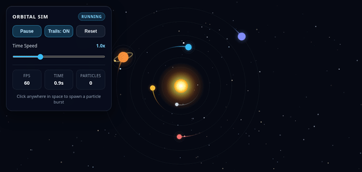
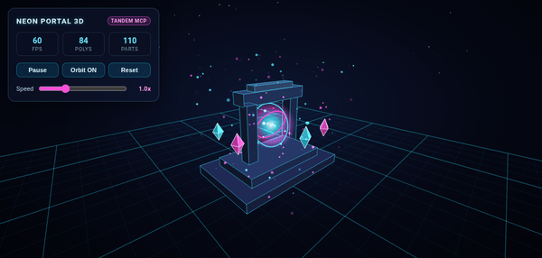

<div align="center">

<h1>Tandem MCP</h1>


<p>
  <a href="https://github.com/ALENOC/tandem-mcp/releases"></a>
  <a href="https://github.com/ALENOC/tandem-mcp/actions/workflows/tests.yml"></a>
  <a href="pyproject.toml"></a>
  <a href="LICENSE"></a>
</p>

</div>

Tandem MCP lets the model in your chat hand part of a coding task to a model running on your own machine. A typical request is “fix this function, leave the tests alone, and show me the diff.” The cloud model decides what to hand off. The local model does the edit, and Tandem returns the changes and test results for review.

## Connect your agent

Tandem runs as a local MCP server over standard input and output (stdio). The installer registers it with **Claude Code**, **Codex** and **Antigravity**. You can also register the same server manually in **Gemini CLI** or another client that can launch a local stdio server. Each client handles its own tool permissions. [Setup and manual configuration](docs/GETTING_STARTED.md#3-register-with-your-mcp-client)

## How a delegated edit works

[](assets/architecture.svg)

1. **Your agent sets the task.** Say you ask it to fix a discount calculation. The agent can call `delegate` with the goal, the file the worker may edit and the test to run.
2. **Tandem asks the local model.** The server sends the task and relevant context to your model endpoint. The model can ask to read a file, propose an edit or request a command.
3. **Tandem applies the edit and checks it.** The server handles those tool calls inside the workspace limits. It runs the requested test and records the result and the diff. Command isolation depends on the configured sandbox.
4. **Your agent reviews the result.** It can inspect the diff and test output, report a failure or request a rollback. For a read-only question, it can use a digest tool and ask for the relevant lines directly.

[Architecture in detail](docs/ARCHITECTURE.md) · [Workspace and sandbox permissions](docs/SECURITY_MODEL.md)

## Does it save cloud tokens?

It depends on the task. On the Orbital demo the local worker wrote the whole page and every run passed, using 42.5% fewer cloud tokens than the direct path, at about 17 times the wait. On the harder 3D Portal only one delegated run in three passed, so the cloud cost per working result came out level with doing it directly. For small edits and ordinary chat requests, the tool schemas, the wait and the review cost about as much as writing the code directly.

Figures are **cloud tokens per successful result**, with failed attempts counted, and the **median time** per attempt. Latest runs, Tandem 3.7.0:

| Task | Direct | With Tandem | Cloud tokens |
| --- | --- | --- | ---: |
| Orbital demo, 3 runs | 35,488 · 3/3 · 50 s | 20,410 · 3/3 · 14 min | **-42.5%** |
| 3D Portal demo, 3 runs | 74,372 · 2/3 · 82 s | 75,769 · 1/3 · 40 min | **+1.9%** |
| Boids animation in chat, 3 runs | 33,532 · 3/3 · 54 s | 33,214 · 3/3 · 9.5 min | -0.95% |
| Python fix in chat, 1 run | 26,953 · 1/1 · 24 s | 33,479 · 1/1 · 105 s | +24.2% |

The local model also uses tokens, power and time on your machine: about 61,000 local tokens per Orbital run and 219,000 per Portal run. By default Tandem acts directly on the first turn and delegates only large from-scratch work when you ask to save cloud tokens. [All results and method](docs/BENCHMARKS.md) · [Decision report (Italian)](docs/DECISION_REPORT_20261120.md)

### Orbital simulation

<table>
  <tr>
    <th width="50%">Direct</th>
    <th width="50%">With Tandem</th>
  </tr>
  <tr>
    <td></td>
    <td></td>
  </tr>
  <tr>
    <td align="center">Run 1 · 3 of 3 direct runs passed</td>
    <td align="center">Run 1 · 3 of 3 delegated runs passed</td>
  </tr>
</table>

### 3D neon portal

<table>
  <tr>
    <th width="50%">Direct</th>
    <th width="50%">With Tandem</th>
  </tr>
  <tr>
    <td></td>
    <td></td>
  </tr>
  <tr>
    <td align="center">Run 3, passed · 2 of 3 direct runs passed</td>
    <td align="center">Run 2, the only delegated run of 3 that passed</td>
  </tr>
</table>

The delegated portal passes every automated check, but its solid floor and particle trails look busier than the direct version.

## Try it

Start a local OpenAI-compatible model server and load a model. LM Studio usually listens at `http://127.0.0.1:1234/v1`. You will also need Python 3.11 or newer and, for secure command execution on Linux, Bubblewrap.

```sh
git clone https://github.com/ALENOC/tandem-mcp
cd tandem-mcp
python3 -m venv .venv
.venv/bin/pip install .
.venv/bin/python scripts/install.py
```

Restart your MCP client, open a project and try a read-only request:

> Use Tandem to find where this project validates its input. Give me the file names and line numbers.

For a first edit, pick a failing test and tell the worker which file it may change:

> Use Tandem to fix the discount calculation in discount.py. Keep the tests unchanged, run them, and show me the diff.

For manual setup or a different model endpoint, see [Getting Started](docs/GETTING_STARTED.md) and [Configuration](docs/CONFIGURATION.md). The decision report describes the experimental routing used in the chat benchmarks. The released server's tools are listed in the [tool reference](docs/TOOLS.md).

[Changelog](CHANGELOG.md) · [Security policy](SECURITY.md) · [MIT license](LICENSE) · Copyright (c) 2026 [Alessandro Nocentini](https://github.com/ALENOC)
