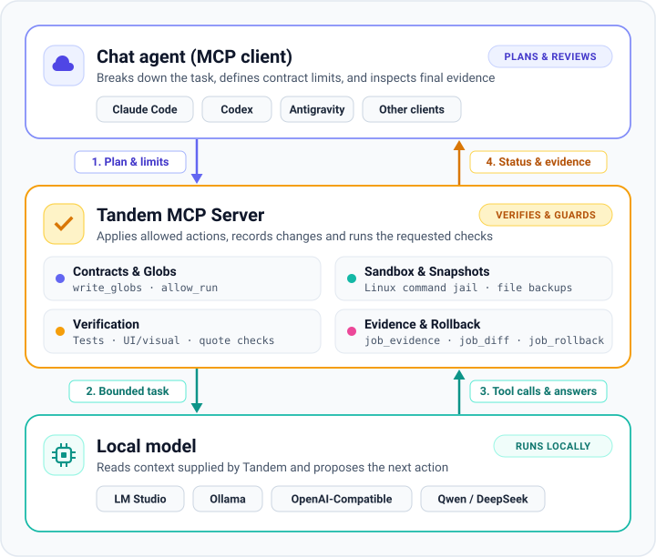
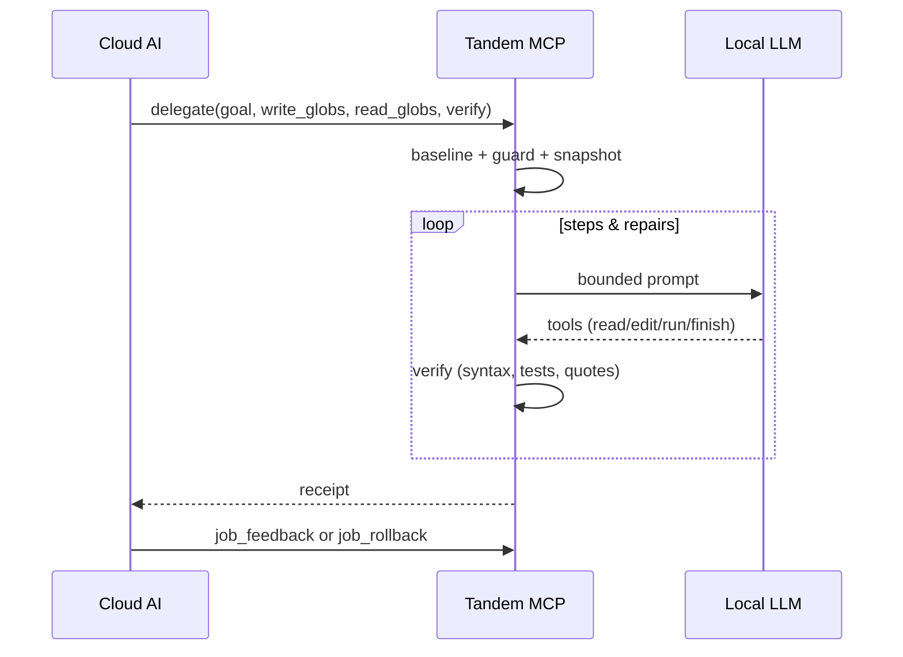

# Architecture

Tandem MCP pairs a **cloud AI orchestrator** (which keeps architectural decisions, contracts, and final review) with a **local LLM executor** (which reads large files and performs bounded edits on the machine).

Printable architecture overviews:
- [Architecture PDF (English)](tandem-mcp-architecture.pdf)
- [Architettura PDF (Italiano)](tandem-mcp-architettura.pdf)

The PDFs are built from [`pdf-src/`](pdf-src) with `sh docs/pdf-src/build.sh`.

## System Flow

   Tandem MCP Server -> Local AI Executor">

## Core Modules

| Module | Responsibility |
| --- | --- |
| `tandem_mcp/server.py` | MCP tool definitions, strict contract validation, receipts, `job_feedback` gates, secret redaction |
| `tandem_mcp/engine.py` | Parallel server discovery, capability probing (`tools`, `schema`, `thinking`, `tps`), role routing, retry with backoff |
| `tandem_mcp/digest.py` | Chunked reading, wave-parallel map-reduce, lexical quote checking, numeric grounding, claim consistency, schema-validated extraction merge |
| `tandem_mcp/agent.py` | Delegated task loop, internal executor tools (`replace_in_file` multi-edit, `rg --json` search), journal, snapshot, `restore_guard`, batches, rollback |
| `tandem_mcp/sandbox.py` | Path/glob normalization, command parser (`split_command`), `allow_run`/`DENY`, outbound symlink refusal, SHA-256 `stamp()`, Bubblewrap allowlist jail |
| `tandem_mcp/ui_test.py`, `_ui_test.mjs` | `tandem:ui_test` scenarios from the contract, run in headless Chromium (click, input, key, expect moving or static, text, color, snapshot, differs) |
| `tandem_mcp/web_check.py`, `_web_probe.mjs` | Built-in runtime and animation check for web deliverables (JavaScript errors, controls, Pause and Reset, bright canvas) |
| `tandem_mcp/router.py` | `auto_route`: chooses deterministic tools, a direct answer or local delegation, and estimates the local success rate per task family |
| `tandem_mcp/host_runner.py` | Host-managed loop: a local process waits for the job with no cloud polling (`TANDEM_HOST_MANAGED=1`) |
| `tandem_mcp/store.py` | Persistence under `TANDEM_HOME` (`jobs/`, `blobs/`, `ledger.jsonl`, `lessons.jsonl`, `models.json`, `cache/`), `flock` cross-process job locks, startup reconciliation |

## Delegation Lifecycle

1. **Contract validation:** `delegate` and `delegate_many` validate `goal`, `write_globs`, `verify_commands`, and `constraints` (enforced by default under `TANDEM_STRICT=1`).
2. **Baseline & protection:** `verify_commands` run before any edit (pre-passing checks are flagged as `weak`). Test files and folders are marked read-only (`guard`) and restored if touched.
3. **Executor tool loop:** The local model works inside `Workspace` using `list_files`, `read_file`, `search`, `replace_in_file`, `write_file`, `run`, and `finish`. Every file edit is journaled (`journal_bin.json` + `blobs/`) and every `run` is preceded by a workspace snapshot and `stamp()`. The conversation only grows at its end, so the model server reuses its cached prompt at every step: the state of the work is added to the end of each request and never stored, a `write_file` is compacted only once its file changes again or the context passes 60% of its budget (and stays compacted), and past the budget old results are cut once, down to 70% of it.
4. **Verification & repair:** On `finish`, Tandem restores guarded files, checks syntax on modified files, runs `verify_commands` in the sandbox, and verifies constraint quotes lexically. Failures are sent back to the executor up to `max_repairs`; a long check output is cut around the lines that name a failure, so the failing step of a long UI test is never dropped. The third finish in a row that changes no file and fails in the same checks ends the job as `stuck`, and so does the third in a row with the same failing lines after changes that did not touch them. A check that passes but runs longer than `TANDEM_SLOW_CHECK_S` goes back to the executor once, with the line of its output that came after its longest silence.
5. **Review & rollback:** The orchestrator receives a compact receipt, inspects `job_evidence` or `job_diff`, and closes with `job_feedback` or undoes changes with `job_rollback` (which checks `post_state.json` to avoid overwriting later user edits).

## Autonomous Profile

With `TANDEM_PROFILE=autonomous` the server exposes four tools (`delegate`, `job_continue`, `job_status`, `job_rollback`). The orchestrator writes the contract once; `delegate` blocks while steps 3 and 4 above repeat locally until every check passes or `TANDEM_JOB_SECONDS`, `TANDEM_MAX_REPAIRS` or `TANDEM_MAX_STEPS` runs out. No cloud call happens meanwhile; an MCP progress notification every `TANDEM_PROGRESS_SECONDS` keeps the client from aborting the call. The orchestrator gets back one `ACCEPTED` line, or only the checks that still fail. See [Benchmarks](BENCHMARKS.md).

## Reading & Extraction Pipeline

- **`digest_file` / `digest_many`:** Splits large files into context-sized chunks, runs wave-parallel map calls (`TANDEM_DIGEST_WORKERS`), verifies every quote against the source (`check_evidence`), flags ungrounded numbers (`loose_numbers`), and checks polarity/comparison consistency (`check_claim_support`).
- **`extract_from_file`:** Extracts structured JSON per chunk, merges results deterministically by schema (`_merge_extractions`), validates against the target JSON schema (`engine.problem`), and lists any extracted values not found verbatim in the source.
