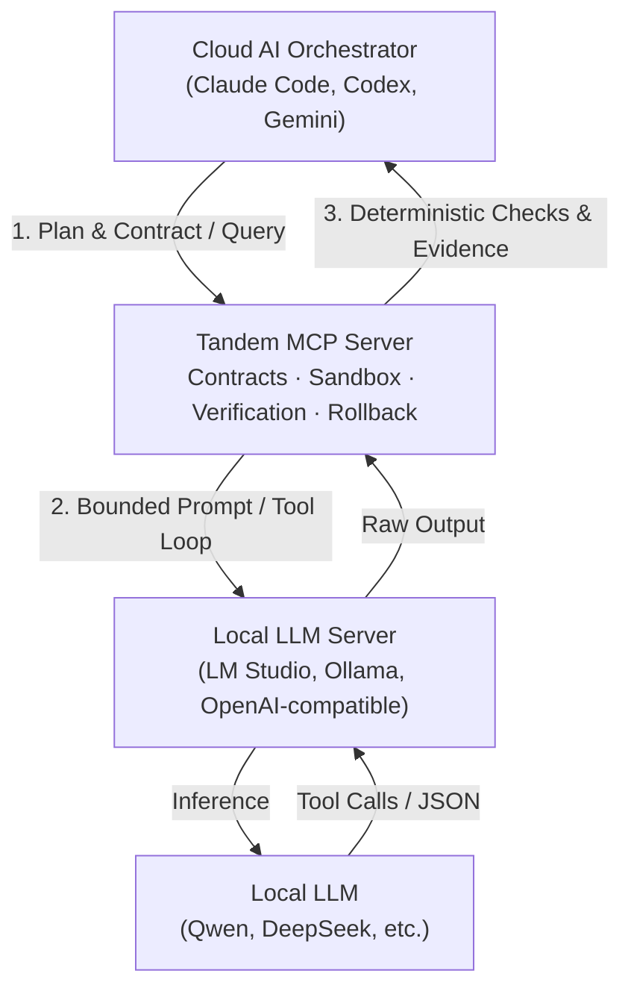

# Architecture

Tandem MCP pairs a **cloud AI orchestrator** (which keeps architectural decisions, contracts, and final review) with a **local LLM executor** (which reads large files and performs bounded edits on the machine).

Printable architecture overviews:
- [Architecture PDF (English)](tandem-mcp-architecture.pdf)
- [Architettura PDF (Italiano)](tandem-mcp-architettura.pdf)

## System Flow

## Core Modules

| Module | Responsibility |
| --- | --- |
| `tandem_mcp/server.py` | MCP tool definitions, strict contract validation, receipts, `job_feedback` gates, secret redaction |
| `tandem_mcp/engine.py` | Parallel server discovery, capability probing (`tools`, `schema`, `thinking`, `tps`), role routing, retry with backoff |
| `tandem_mcp/digest.py` | Chunked reading, wave-parallel map-reduce, lexical quote checking, numeric grounding, claim consistency, schema-validated extraction merge |
| `tandem_mcp/agent.py` | Delegated task loop, internal executor tools (`replace_in_file` multi-edit, `rg --json` search), journal, snapshot, `restore_guard`, batches, rollback |
| `tandem_mcp/sandbox.py` | Path/glob normalization, command parser (`split_command`), `allow_run`/`DENY`, outbound symlink refusal, SHA-256 `stamp()`, Bubblewrap allowlist jail |
| `tandem_mcp/store.py` | Persistence under `TANDEM_HOME` (`jobs/`, `blobs/`, `ledger.jsonl`, `lessons.jsonl`, `models.json`, `cache/`), `flock` cross-process job locks, startup reconciliation |

## Delegation Lifecycle

1. **Contract validation:** `delegate` and `delegate_many` validate `goal`, `write_globs`, `verify_commands`, and `constraints` (enforced by default under `TANDEM_STRICT=1`).
2. **Baseline & protection:** `verify_commands` run before any edit (pre-passing checks are flagged as `weak`). Test files and folders are marked read-only (`guard`) and restored if touched.
3. **Executor tool loop:** The local model works inside `Workspace` using `list_files`, `read_file`, `search`, `replace_in_file`, `write_file`, `run`, and `finish`. Every file edit is journaled (`journal_bin.json` + `blobs/`) and every `run` is preceded by a workspace snapshot and `stamp()`.
4. **Verification & repair:** On `finish`, Tandem restores guarded files, checks syntax on modified files, runs `verify_commands` in the sandbox, and verifies constraint quotes lexically. Failures are sent back to the executor up to `max_repairs`.
5. **Review & rollback:** The orchestrator receives a compact receipt, inspects `job_evidence` or `job_diff`, and closes with `job_feedback` or undoes changes with `job_rollback` (which checks `post_state.json` to avoid overwriting later user edits).

## Reading & Extraction Pipeline

- **`digest_file` / `digest_many`:** Splits large files into context-sized chunks, runs wave-parallel map calls (`TANDEM_DIGEST_WORKERS`), verifies every quote against the source (`check_evidence`), flags ungrounded numbers (`loose_numbers`), and checks polarity/comparison consistency (`check_claim_support`).
- **`extract_from_file`:** Extracts structured JSON per chunk, merges results deterministically by schema (`_merge_extractions`), validates against the target JSON schema (`engine.problem`), and lists any extracted values not found verbatim in the source.
