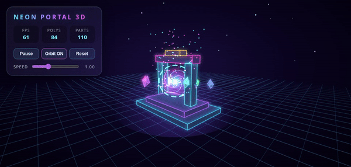
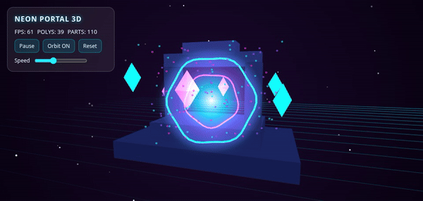
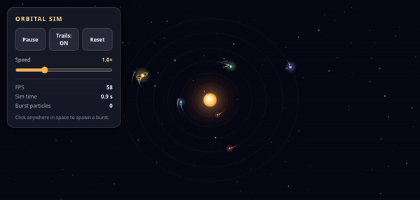
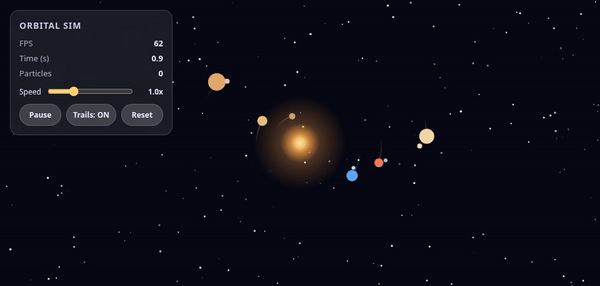

# Benchmarks

Tandem **4.2.0**, November 2026. Cloud orchestrator: **Opus 5.5** in Claude Code. Local executor and visual reviewer: `qwen3.8-27b@iq3_s` on LM Studio, loaded as a vision model. Earlier campaigns with other orchestrators were removed from the repository and stay in the git history.

## Method

Each task is run as a counterbalanced pair in fresh workspaces:

- **Direct:** Opus does the work itself. No MCP server is loaded.
- **With Tandem:** the same request with the fixed suffix "Usa Tandem.", and the Tandem MCP server in the autonomous profile (`TANDEM_PROFILE=autonomous`, fresh `TANDEM_HOME` per attempt). Opus writes a contract and calls `delegate` once. The call blocks while the local model writes, runs the checks and repairs, with no cloud call. Opus gets back a one-line `ACCEPTED`, or only what still fails. On web work the receipt also carries the live 1280x800 screenshot as MCP image content, and the local model reviews that screenshot against the contract before the job is accepted.

Both arms run `claude -p` with the same isolated setup: `--setting-sources ""` (no user settings, plugins or `CLAUDE.md`), `--disable-slash-commands`, `--strict-mcp-config`, permissions bypassed. The arm that runs first alternates from pair to pair. The Tandem code of each run is copied before the first attempt and its SHA-256 is recorded.

**Cloud cost** is `total_cost_usd` from the `result` event of `claude -p --output-format json` (list prices, every model used in the attempt). Input, cache writes, cache reads and output tokens are recorded too. **Main metric:** cloud cost per successful result, with failed attempts counted in the cost:

    cost per success = cost of all attempts / successful attempts

An attempt **succeeds** when an independent evaluator, which neither arm sees, passes it three times in a row and the attempt ended inside its time budget. The 4.2.0 run uses the exact same evaluators as 4.0.0 and 4.1.0: the SHA-256 of the five `check_*.mjs` files matched `REEVAL_V3.json` 5/5 before and after the run, and `tasks.py`, `reeval.py`, `run_pair.py` and `render_gifs.mjs` were unchanged. The local model also costs time and power; those are reported next to the cloud figures.

Runner: [`run_pair.py`](../benchmarks/opus/run_pair.py) · Tasks and evaluators: [`tasks.py`](../benchmarks/opus/tasks.py) · Re-evaluation: [`reeval.py`](../benchmarks/opus/reeval.py) · 4.2.0 report: [`REEVAL_4_2.json`](../benchmarks/opus/REEVAL_4_2.json) · 4.1.0 combined report: [`REEVAL_4_1.json`](../benchmarks/opus/REEVAL_4_1.json) · 4.0.0 baseline report: [`REEVAL_V3.json`](../benchmarks/opus/REEVAL_V3.json)

Interactive version, also on mobile: [alenoc.github.io/tandem-mcp](https://alenoc.github.io/tandem-mcp/) (built from [`site/`](../site) by `scripts/build_site.py`).

## Test machine and local model

All local work ran on one desktop PC; the local model ran entirely on the GPU.

| Part | Value |
| --- | --- |
| CPU | Intel Core i9-9900K, 8 cores, 16 threads, 3.6 GHz |
| GPU | AMD Radeon RX 6800 series (Navi 21), 16 GB VRAM |
| RAM | 22 GiB available to the system |
| OS | Ubuntu 26.04.1 LTS, Linux 7.0 |
| Model server | LM Studio, llama.cpp Vulkan runtime 2.82.0 |

| Local model setting | Value |
| --- | --- |
| Model | Qwen3.8 27B, unsloth GGUF `Qwen3.8-27B-UD-IQ3_S.gguf` (LM Studio id `qwen3.8-27b@iq3_s`) |
| Vision projector | `mmproj-F16.gguf` (885 MB), so LM Studio loads the model as `type=vlm` and the same model does the visual review |
| Quantization | IQ3_S (about 3 bits per weight), 12.0 GB on disk |
| Context length | 40,960 tokens (65,536 in 4.1.0; reduced to fit the vision projector in 16 GB; the model supports 262,144) |
| GPU offload | all layers |
| KV cache | K in `q8_0`, V in `q4_0` |
| Parallel sessions | 1 |
| CPU threads | 8 |
| Evaluation batch | 1,024 |
| Reasoning | on, budget 1,024 tokens (LM Studio model defaults) |
| Sampling sent by Tandem | temperature 0.1 (0.7 for 2 replies after 3 identical repeated calls), up to 12,000 tokens per executor step (`TANDEM_REPLY_TOKENS`), native tool calls, prefix-stable prompt cache |
| Other LM Studio sampling defaults | top-k 20, repeat penalty 1.0 |
| Tandem limits and gates per job | `TANDEM_JOB_SECONDS` = task budget minus 5 minutes, `TANDEM_MAX_REPAIRS` 20, `TANDEM_MAX_STEPS` 160, `TANDEM_WEB_MIN_FPS` 40, `TANDEM_SLOW_CHECK_S` 30 |
| Visual review (4.2.0 defaults) | `TANDEM_VISUAL_REVIEW=auto` (stateless local review of the 1280x800 screenshot when the loaded model is a VLM), `TANDEM_MAX_VISUAL_REPAIRS` 2, `TANDEM_RECEIPT_SCREENSHOT=1` (screenshot attached to the receipt) |

The cloud side was Opus 5.5 (`claude-opus-5-5`) in Claude Code 2.1.331.

## Results (4.2.0)

One campaign from scratch: run `20261124-174810_v4_2` (clean git state `74340f3`), 5 tasks x 3 counterbalanced pairs, 15 attempts per arm, 17:48 to 00:20.

| Task | Budget | Direct: cost per success | Tandem: cost per success | Change |
| --- | ---: | --- | --- | ---: |
| 5-line bug fix (`py_discount`) | 15 min | $0.0618 · 3/3 · 10 s | $0.0670 · 3/3 · 2.0 min | **+8%** |
| Cron parser module with tests | 40 min | $0.2683 · 3/3 · 60 s | $0.2098 · 2/3 · 26 min | **-22%** |
| Boids web simulation | 40 min | $0.2047 · 3/3 · 54 s | $0.1268 · 3/3 · 11 min | **-38%** |
| Orbital web simulation | 40 min | $0.9512 · 1/3 · 86 s | $0.4672 · 1/3 · 12 min | **-51%** |
| 3D neon portal (4 files) | 70 min | no success, $0.5773 per attempt · 0/3 · 2.5 min | $0.5479 · 1/3 · 33 min | Direct 0/3 (-68% per attempt) |
| **All 15 attempts per arm** | | **$4.29 total · 10/15 · $0.429 per success** | **$2.02 total · 10/15 · $0.202 per success** | **-53% total, -53% per success** |
| **Without the Direct API stall (14 vs 15)** | | **$3.94 total · 10/14 · $0.394 per success** | **$2.02 total · 10/15 · $0.202 per success** | **-49% per success** |

Each cell gives the cost per success, the successes inside the budget and the median time per attempt. Ignoring the budget, Direct delivers 11/15 (Orbital pair 1, late) and Tandem 11/15 (Cron pair 2, late and patched by Opus, see below).

| Cloud tokens, all 15 attempts | Direct | With Tandem | Change |
| --- | ---: | ---: | ---: |
| Output | 123,133 | 39,635 | **-68%** |
| Cache writes | 197,585 | 128,553 | -35% |
| Cache reads | 1,218,017 | 971,510 | -20% |
| Local model tokens (free) | 0 | 3,726,662 | |

Output tokens are the most expensive part of the cost, and Tandem moves most of them to the local model.

### Every Tandem attempt

| Task | Pair | Local job | Evaluator | Cloud cost | Time | Opus `job_continue` | VLM review |
| --- | ---: | --- | --- | ---: | ---: | --- | --- |
| 5-line fix | 1, 2, 3 | verified | pass, pass, pass | $0.082, $0.059, $0.060 | 2.0, 2.2, 1.8 min | none | n/a |
| Cron | 1 | verified | pass | $0.113 | 26 min | none | n/a |
| Cron | 2 | out of time, twice | late (artifact passes) | $0.202 | 71 min | 1 functional hint | n/a |
| Cron | 3 | verified | pass | $0.105 | 25 min | none | n/a |
| Boids | 1 | verified | pass | $0.122 | 13 min | none | failed, 2 strikes (false positive) |
| Boids | 2 | blocked | pass | $0.134 | 11 min | none | not run |
| Boids | 3 | verified | pass | $0.124 | 10 min | none | passed |
| Orbital | 1 | verified | fail (`trailsToggle`) | $0.174 | 12 min | 1 visual hint | passed |
| Orbital | 2 | verified | fail (`pauseStopsTime`, `clickSpawnsBurst`) | $0.135 | 11 min | none | passed |
| Orbital | 3 | verified | pass | $0.159 | 14 min | 1 visual hint | passed |
| Portal | 1 | stuck | fail (`interactions`) | $0.285 | 33 min | none | not run |
| Portal | 2 | verified | pass | $0.150 | 40 min | 1 visual hint | passed |
| Portal | 3 | verified | fail (`interactions`) | $0.113 | 17 min | none | passed |

### Incidents and attempts that need a note

Every attempt is in the totals above; nothing was excluded or re-run.

- **Direct Orbital (pair 1): cloud API stall.** The attempt took 4,946 s against a 40-minute budget with only 3 turns; `duration_api_ms` is 4,944 s, so the time was spent waiting on the API, not working. The page passes the evaluator 3/3. It counts as a failure; the row "Without the Direct API stall" shows the totals without it.
- **Tandem Cron (pair 2): Opus fallback after a local failure.** The local job ran out of its 35-minute window with unit tests still failing. Opus sent one `job_continue` hint with the two bugs, which opened a second full 35-minute window, and the job ran out of time again. Opus then patched `cron_sched.py` itself through Bash. The final file passes the evaluator, but the attempt ran 4,244 s (31 minutes over budget) and counts as a failure. The second time window from `job_continue` is a 4.2.0 limit: it does not account for time already spent.
- **Tandem Portal (pair 1): Opus fallback after a local failure.** The local job stopped as `stuck` after 4 repairs (the same `ui_test` step failed at three finishes in a row). Opus then patched `app.js` itself through Bash (grid clipping at the camera near plane). The result still fails `interactions` and draws 12 to 13 FPS at 1280x800 (`shadowBlur` on every shape). It counts as a failure.
- **Tandem Boids (pair 2): `blocked`.** The local model stopped and reported that step 14 of Opus's `ui_test` redeclared `const s` in the same scope as step 9, so the check itself was broken. Opus only inspected the file (no edits). The page is entirely local work and passes the evaluator.
- **Evaluator flakiness:** Direct Orbital pairs 1 and 3 failed `clickSpawnsBurst` in the check run right after the attempt but passed 3/3 in the re-evaluation, which is the verdict used. All 30 re-evaluations agreed across their three repetitions.
- **Local infrastructure:** no GPU reset (`journalctl -k` has no `amdgpu` errors in the run window), no `llama-server` crash, and `qwen3.8-27b@iq3_s` stayed loaded as `vlm` with a 40,960-token context from start to end. The only LM Studio errors were the routine `GET /props` and `GET /api/tags` probes.

## Visual review and screenshots

4.2.0 adds two visual channels for web work. **Local:** after the checks pass, the local VLM looks at the 1280x800 screenshot with the contract (stateless, one image, no history) and can send the job back up to 2 times. **Cloud:** the same screenshot is attached to the receipt as MCP image content, so Opus sees the page without opening a browser.

| Measure | v4_2 |
| --- | --- |
| Tandem web jobs with a screenshot on the receipt | 9/9 |
| Local VLM reviews run | 7 of 9 (not run on the `stuck` and `blocked` jobs, which never reached acceptance) |
| Local VLM verdicts | 6 passed, 1 failed |
| Local `visual_strikes` (jobs sent back by the VLM) | 2, both in Boids pair 1, both false positives |
| Opus `job_continue` hints after seeing the screenshot | 3 (Orbital pair 1: HUD numbers without labels; Orbital pair 3: speed readout overflowing the HUD; Portal pair 2: one-direction grid and nearly invisible rings) |
| Opus `job_continue` hints without a screenshot | 1 (Cron pair 2, functional) |

- **The two VLM strikes were false positives caused by the probe.** For a page that must start paused, the web probe clicks Play to check the animation (`_web_probe.mjs:278`) and only then captures the "initial view" (`:289`). The screenshot therefore showed "Pause", and the VLM reported that the page started running. The `ui_test` had already verified the `Play` label at startup. The job spent its 2 visual repairs on this and was accepted with the review note. It was the longest Boids job (13 min against 10 to 11 min) and cost no extra cloud tokens. Fix for the next version: capture before any click.
- **Opus hints after the screenshot fixed what they targeted.** The second screenshots show labelled HUD numbers (Orbital pair 1), a HUD that fits (Orbital pair 3), and a cross grid with visible rings (Portal pair 2). Each hint added one short cloud turn ($0.02 to $0.04 against the hint-free attempts of the same task) and a few minutes of local time. Two of the three hinted attempts passed; Orbital pair 1 failed `trailsToggle`, a behaviour the HUD hint did not touch.
- **Frame rate:** measured with Tandem's own probe on every web artifact at 1280x800, twice each. All Tandem pages that passed run at 60 FPS; the only slow Tandem page is the Opus-patched Portal pair 1 (12 to 13 FPS). On Direct, Portal pair 1 runs at 36 FPS and one Boids pair 3 sample measured 36 FPS (60 on the second). In 4.1.0 the final Tandem portal ran at 38 to 39 FPS and the 4.0.0 portals at 4 to 20 FPS.

## From 4.0.0 to 4.1.0 to 4.2.0

The same four medium and large tasks (`py_cron`, `web_boids`, `gen_orbital`, `gen_portal`) across the three versions:

| Metric (4 shared tasks) | 4.0.0 (`v3`, 3 pairs) | 4.1.0 series (4 pairs) | 4.2.0 (`v4_2`, 3 pairs) |
| --- | --- | --- | --- |
| Tandem successes in budget | 6/12 (50%) | 11/16 (69%) | 7/12 (58%) |
| Direct successes in budget | 8/12 (67%) | 10/16 (63%) | 7/12 (58%) |
| Tandem cloud cost per success | $0.245 | $0.217 | $0.259 |
| Direct cloud cost per success | $0.498 | $0.556 | $0.586 |
| Tandem saving per success | -51% | -61% | -56% |
| Tandem median wall time | 25 min (1,508 s) | 19 min (1,137 s) | 16 min (935 s) |
| Direct median wall time | 75 s | 86 s | 76 s |
| 3D portal frame rate, Tandem | 4, 8 and 20 FPS | 55 to 60 FPS (pilot, confirm), 38 to 39 FPS (final) | 60 FPS on all three local results |
| Visual feedback | none | none | local VLM review and screenshot on the receipt |

All five tasks: 4.0.0 had Tandem at $0.180 per success (9/15) against $0.375 direct (11/15), -52%; 4.2.0 has $0.202 (10/15) against $0.429 (10/15), -53%. The 4.1.0 series did not run the 5-line fix.

What changed in 4.2.0, and what it did in this run:

- **Context 65,536 to 40,960 tokens** to fit the vision projector on the same 16 GB GPU.
- **Screenshot on the receipt:** Opus used it 3 times to send a visual hint, the first time the cloud side could judge the look of a Tandem page without spending tokens on a browser session.
- **Local VLM review:** it ran on every accepted web job; its only intervention was the false positive above.
- **Cost per success went up slightly on the shared tasks** ($0.217 to $0.259) because the Tandem success rate dropped (69% to 58%) with the same per-attempt cost. Direct dropped too (63% to 58%), so the saving stays between 51% and 61% across the three versions. With 3 or 4 pairs per task, these success-rate changes are within noise.

## What the numbers mean

- **Small edits do not pay:** the 5-line fix cost `+8%` with Tandem (`$0.0670` against `$0.0618`), in line with `+10%` in 4.0.0. The guide tells Opus to do edits under about 30 lines itself.
- **Medium and large work saves 22% to 51% per success** on the tasks where both arms succeeded, and Tandem delivered the only working 3D portal. Overall `-53%` per success (`$0.202` against `$0.429`), or `-49%` without the Direct API stall.
- **Where Tandem lost:** the 5-line fix (+8%), one Cron attempt (local job out of time, then an Opus patch, 31 minutes over budget) and two Portal attempts (one stuck then patched by Opus, one that passed every local check but fails the evaluator's `interactions`).
- **Time:** a Tandem result takes a median of 11 to 33 minutes on medium and large tasks (about 12x slower than direct), the inherent trade-off of a local 27B model on a consumer GPU.
- **Sample size:** with 3 pairs per task, a 1-success difference is not statistically decisive.

## Quality

Screens of every web artifact were captured at 1280x800 with Tandem's own probe and compared side by side.

- **Boids:** equivalent. All six pages run at 60 FPS with the requested HUD and controls.
- **Orbital:** both arms are clean and run at 60 FPS. Direct adds polish not asked for in the prompt (glow halos, a ringed planet, tapered trails, a usage hint line); Tandem pages are plainer. The evaluator fails most pages of both arms on intermittent interaction checks (1/3 each).
- **3D portal:** Direct portals are the richest scenes of the run (swirling core, glow, full neon grid) but none passed: pair 1 fails `interactions` and `visual` and draws 36 FPS, pair 2 fails `interactions`, pair 3 fails `visual`. The only Tandem portal that passed (pair 2) is correct and runs at 60 FPS, but it is small in the frame and plain even after Opus's visual hint. Tandem pair 3 is the best-looking local portal (framed glowing core) but fails `interactions`.

The local model does only what the contract says. The guide therefore asks Opus to keep requested labels verbatim, write the contract in the user's language, and state palette, layout and finish for UI work; the screenshot on the receipt now lets Opus check the finish.

### 3D neon portal

<table>
  <tr><th width="50%">Direct (v4_2, pair 2)</th><th width="50%">With Tandem (v4_2, pair 2)</th></tr>
  <tr>
    <td></td>
    <td></td>
  </tr>
  <tr>
    <td align="center">$0.59 cloud · 134 s · failed (interactions) · 60 FPS</td>
    <td align="center">$0.15 cloud · 40 min · passed · 60 FPS · 1 visual hint</td>
  </tr>
</table>

### Orbital simulation

<table>
  <tr><th width="50%">Direct (v4_2, pair 3)</th><th width="50%">With Tandem (v4_2, pair 3)</th></tr>
  <tr>
    <td></td>
    <td></td>
  </tr>
  <tr>
    <td align="center">$0.30 cloud · 86 s · passed · 60 FPS</td>
    <td align="center">$0.16 cloud · 14 min · passed · 60 FPS · 1 visual hint</td>
  </tr>
</table>

Both pairs were picked by rule: the same pair for both arms, and for Tandem only pages written by the local model. For the portal, pair 2 holds the only Tandem success; for the orbital simulation, pair 3 is the only pair where both arms pass.

## Open limits

- The web probe captures the "initial" screenshot after it has clicked Play, which misleads the visual review on pages that must start paused.
- `job_continue` opens a new full time window, so a continued job can run far past the task budget.
- When a local job fails, Opus sometimes patches the files itself in the same attempt: it edited through Bash in 2 of 15 Tandem attempts, and neither patch rescued the attempt.
- The evaluator's interaction checks on Orbital and Portal are intermittent on both arms; the run-time and re-evaluation verdicts differed on 2 Direct attempts.
- Visual polish remains stronger on the direct path.

## Earlier baseline and how the version was reached

The repository keeps all earlier iterations in `benchmarks/opus/runs/`.

- **4.1.0 series (`20261124-030230_adversarial_pilot1`, `20261124-052842_adversarial_confirm`, `20261124-103103_adversarial_final`, [`REEVAL_4_1.json`](../benchmarks/opus/REEVAL_4_1.json)):** 4 tasks x 4 pairs. Direct `$5.56` total, `10/16` (`$0.556`/success); Tandem `$2.39` total, `11/16` (`$0.217`/success, `-61%` per success, `-67%` output tokens). The final run had one incident per arm: a GPU reset during Tandem Orbital (Opus wrote the page itself) and a 74-minute API stall during Direct Cron.
  - **Round 1 (`pilot1`):** prefix-stable conversation, lazy write compaction, 12,000-token reply budget, temperature bump on repeated calls, 40 FPS web-check gate, verbatim label rule.
  - **Round 2 (`confirm`):** failing lines preserved when trimming long check outputs, early `stuck` stop on repeated identical failures.
  - **Round 3 (`final`):** slow passing check gate (`TANDEM_SLOW_CHECK_S=30`), `stuck` threshold at 3 repeated failures, repeated-failure receipt guidance, and explicit error receipts when the model server fails before saving a conversation.
- **4.0.0 baseline (`v3`, `20261121-215741_v3`, [`REEVAL_V3.json`](../benchmarks/opus/REEVAL_V3.json)):** 5 tasks x 3 pairs (15 attempts per arm), including the 5-line `discount.py` fix (`$0.0457` direct vs `$0.0504` Tandem, `+10%`). Overall: Direct `$4.12` total, `11/15` ok (`$0.375`/success); Tandem `$1.62` total, `9/15` ok (`$0.180`/success, `-52%` per success, `-61%` total, `-72%` output tokens). Revealed slow 3D portals (4 to 20 FPS) and long local loop times.
- **`v4` (`20261122-110735_v4`):** expanded run with read and sorting tasks; exposed prompt-cache invalidation (about 50% of local wall time across v3/v4), 36 cut-off replies under the 4,000-token limit, and translated UI labels when an English prompt carried the Italian suffix "Usa Tandem".
- **v1 & v2 (`20261121-151815_full`, `20261121-183640_orbital_p1_tandem`, `20261121-191242_orbital_p2p3`, `20261121-211511_v2`):** early autonomous profile iterations that led to the 50 ms `tandem:ui_test` post-action wait, 30 s MCP progress notifications, and the language/finish contract rule.

## Reproduce

    cd benchmarks/opus
    ../../.venv/bin/python run_pair.py --tasks py_discount,py_cron,web_boids,gen_orbital,gen_portal --pairs 3 --tag my_run
    ../../.venv/bin/python reeval.py out.json runs/<run_dir>
    node render_gifs.mjs <workspace_dir> <out.gif>

The GIFs play in real time: each frame keeps the time it covered on the page, so a page that renders slowly shows fewer frames, not faster motion.

`run_pair.py` needs the `claude` CLI logged in, LM Studio with the executor model at `http://127.0.0.1:1234/v1` (load it with its `mmproj` file to enable the local visual review), Node and a Chromium build. A full run takes several hours, mostly spent waiting for the local model; `v4_2` took 6.5 hours.
